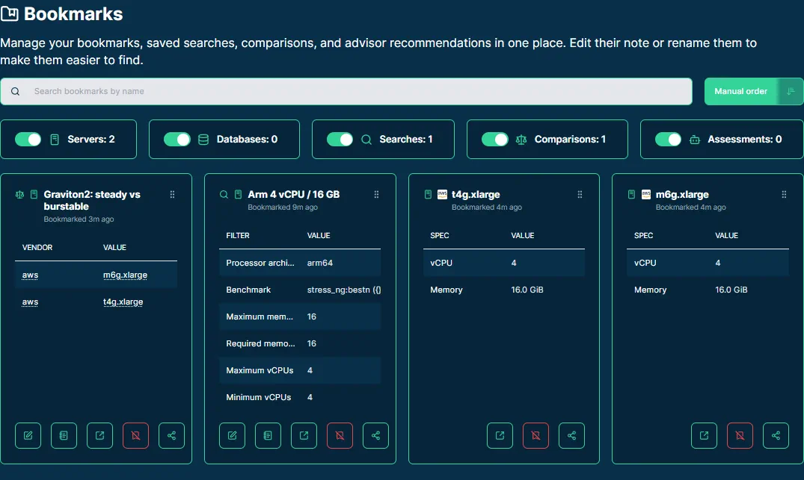

# Create an account and manage bookmarks

A free account lifts the guest limits and lets you bookmark servers,
databases, searches, comparisons, and Advisor assessments. Without one, you
can still use the [listings](./listings.md) and the [Advisor](./advisor.md).
Select **Register** or **Log in** in the top-right corner of the site.

## Guest limits

As a guest, you can use everything except bookmarks, with the following
limits:

- Compare up to four servers, and separately up to four databases, at a time.
- In the **Region** filter, select one country and up to three regions.

You can still open comparison links that others share with you, even when
they hold more servers. When you reach a limit, the site offers to register
you; registering removes the limits. For more on what registration gives you,
see the
[Registered users article](https://sparecores.com/article/registered-users).

You need an account to save bookmarks. Select **Register** and either enter
your name, email address, and password or continue with GitHub. Email
registration requires an email verification code. If you select a gated
bookmark action as a guest, the site can prompt you to register or sign in;
the pending action completes after registration. When signed in, the account
menu includes **Bookmarks**, **Edit Profile**, and **Sign Out**.

## Save servers, searches, and comparisons

To bookmark a server or database, select its bookmark icon in the listing or
on its detail page. The bookmark is saved at once, with no dialog; select the
icon again to remove it.

To save a search, a comparison, or an Advisor assessment:

1. Select the bookmark icon in the page header of the listing, comparison, or
   Advisor page.
2. Enter a **Name** of at least three characters. **Notes** are optional.
3. Select **Confirm** to save.

## Find and manage saved items

Open **Bookmarks** from the account menu. The page groups saved items by type;
its current filters include servers, databases, searches, comparisons, and
assessments. Use the name search, category filters, or ordering controls to
find an item.

The following screenshot shows the Bookmarks page with a saved comparison, a
saved search, and two bookmarked servers:

Each saved item offers the following actions:

- **Open** opens the server, database, search, comparison, or assessment.
- **View note** shows the item's notes.
- **Edit** changes the name and notes of a search, comparison, or assessment.
- **Share** copies the item's link.
- **Delete** removes the item from your bookmarks.
