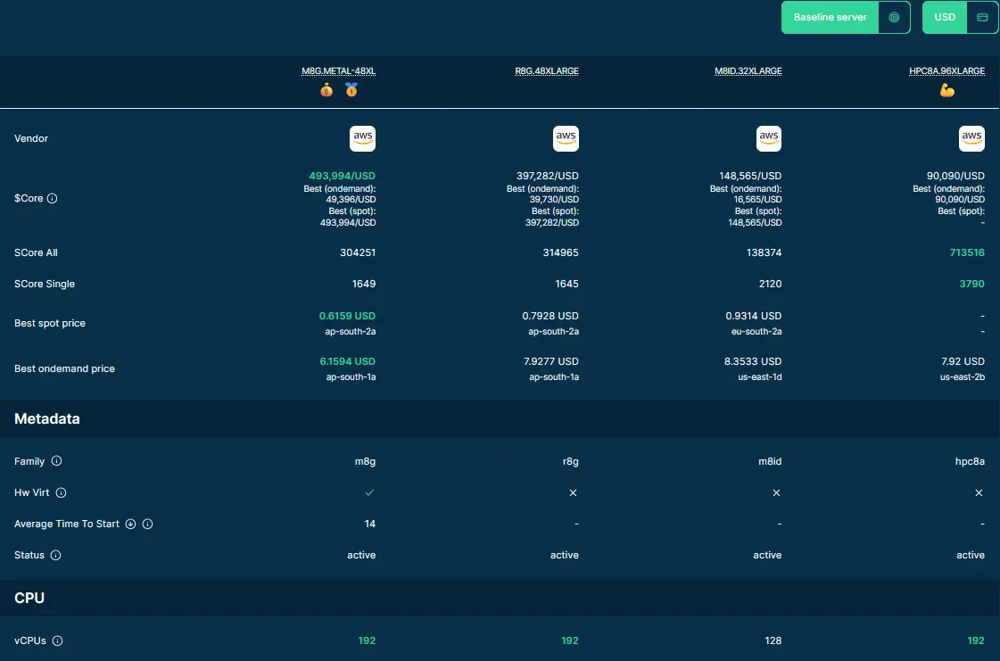

# Compare Servers

You can compare servers from the [Navigator](https://sparecores.com/servers),
from a server detail page, or from the
[Advisor](https://sparecores.com/advisor)'s recommendations.

## Start a Comparison

### From the Navigator

1. Open the [Navigator](https://sparecores.com/servers).
2. Select the checkboxes for at least two servers.
3. Select **Compare (N)**, for example **Compare (3)**, in the bar that
   appears at the bottom of the page, next to **Clear**.

Guests can compare up to four servers at a time. The listing disables further
selection when the guest limit is reached and shows a registration prompt.

### From a Server Detail Page

Open a server from the listing and select **Compare**. The control changes to
**Don't Compare** when that server is in the current selection. Add other
servers the same way or from the listing. Once two or more servers are
selected, the compare icon in the site header shows their number. Select it
to reorder or remove servers or set a baseline, then select
**Compare servers**.

### From the Advisor

In the Advisor, select **Compare baseline**, select the checkboxes of one or
more recommendations, and select **Compare (N)**. The comparison shows the
baseline next to the selected servers. See
[Compare a Recommendation with the Baseline](./advisor.md#compare-a-recommendation-with-the-baseline).

## Read a Comparison

The comparison page places the selected servers side by side: property
sections such as CPU, Memory, and Storage, then **Workload Profiles**,
benchmark sections, and **Further Benchmarks**. Use the following cues to
read it:

- The best value in each row is highlighted in bold green.
- Badges on the server columns mark the lowest price (💰), the best value for
  price (🥇), and the top performance (💪).

The page also has a currency control and a **Baseline server** selector.
Choose a baseline to see how the other servers differ from it: its column is
underlined in green, and rows such as prices and CPU speed show each
server's difference as a percentage, green where it beats the baseline and
red where it falls short. The baseline is kept in the page's URL, so a shared
link keeps it. Choose **No baseline** to remove it.

For what each benchmark workload measures, see the
[Benchmarks reference](https://docs.sparecores.com/benchmarks/).

The [curated server comparisons](https://sparecores.com/servers/compare)
provide preselected groups to explore.

For price display, see [Understand Prices](./prices.md). For guest limits and
bookmarks, see [Accounts and bookmarks](./accounts-and-bookmarks.md).
