# {#cover-slide data-curtain="close"}

<script>
  // add custom CSS for the speaker view
  if (window.self !== window.top) {
    document.body.className += " speakerview";
  }
  // remove dummy slide
  document.getElementById("title-slide").remove();
</script>

::: {.centered}


:::

<h1 class="subtitle" style="color:#eee;font-size:2em; text-align: center; margin-top: 40px; color:#34d399;">
  563 Things<br />Karpenter Didn't Know About
</h1>

<h2 class="author" style="color:#eee;padding-top:65px;font-size:0.9em;text-align: center !important;margin-bottom: 0px;">
  Gergely Daroczi & Attila Nagy, Spare Cores
</h2>

<h3 class="author" style="color:#eee;padding-top: 2px; font-size:0.9em;text-align: center !important; font-weight: normal;">
  Oct 30, 2026 @ Budapest, Hungary
</h3>

<h3 class="author onlineMode" style="color:#eee;padding-top:65px;font-size:0.9em;text-align: center !important; padding-top: 10px;font-weight: normal; ">
  Slides: <a href="https://sparecores.com/talks" target="_blank">sparecores.com/talks</a>
</h3>

<p class="author offlineMode" style="color:#eee;font-size:0.75em;text-align: right !important; padding-top: 0px;font-weight: normal;margin-top:30px; ">
  Press Space or click the green arrow icons to navigate the slides ->
</p>

::: {.notes}
TODO Gergo speaker notes
Gergo: welcome ... last year lightning talk .. lucky you, we are happy to have Attila this year as well
and we decided we will do this in a different way

...

courtain!
:::

# {#teaser data-curtain="open"}

::: {.centered}

:::

<!-- TODO Gergo add "once upon a time, in a not too far pub ...." -->


::: {.notes}
more interactive .. so 

I met Attila a few weeks ago and he mentioned that he is struggling with a problem, and
this was the conversation we had:

G: Hey Attila, ... how are you doing, you look a bit concerned..
A: TODO Attila speaker notes on nehezen skalazhato python app 

- single-core performance,
- we need to pick the optimal server,
- we are fed up with it ...
- we even came up with a mascot for it ...

G: Ah, interesting. I think what we do at Spare Cores might be relevant for you.
A: Really? Could you pls show me what it does and how it can help us?
G: Sure.
:::


# {#recap .center}

```{=html}
<div class="agent-terminal">
  <div class="agent-titlebar">
    <span class="agent-dot close"></span>
    <span class="agent-dot minimize"></span>
    <span class="agent-dot maximize"></span>
    <span class="agent-title">hermes — gergely@big-mac-4</span>
  </div>
  <div class="agent-body">
    <!-- TODO Gergo speed this up .. too slow for a fun moment --> 
    <div class="agent-banner">hermes agent · local model · 🎙 phone mic: recording (1h 47m)</div>
    <div class="agent-step agent-prompt"><span class="agent-ps">❯</span> <span data-type="recap what I just discussed with Attila in the pub"></span><span class="agent-cursor"></span></div>
    <div class="agent-step" data-wait="1200"><span class="agent-running"><span class="agent-spinner"></span> thinking…</span><span class="agent-done"><span class="agent-ok">✓</span> need the pub conversation <span class="agent-meta">→ using the live recording</span></span></div>
    <div class="agent-step" data-wait="2000"><span class="agent-running"><span class="agent-spinner"></span> stopping audio recording on phone…</span><span class="agent-done"><span class="agent-ok">✓</span> recording stopped <span class="agent-meta">(1h 47m 12s, 192 MB, pub-chat.wav)</span></span></div>
    <div class="agent-step" data-wait="5000"><span class="agent-running"><span class="agent-spinner"></span> transcribing locally with whisper…</span><span class="agent-done"><span class="agent-ok">✓</span> transcribed <span class="agent-meta">(2 speakers, 11,382 words, 487 words beeped, 5 beers)</span></span></div>
    <div class="agent-step" data-wait="3000"><span class="agent-running"><span class="agent-spinner"></span> summarizing transcript…</span><span class="agent-done"><span class="agent-ok">✓</span> summarized <span class="agent-meta">(5 key points, 43 off-topic rants skipped)</span></span></div>
    <!-- TODO Gergo review timings, e.g. "oh, thank you, it's super nice saying so from an agent" -->
    <div class="agent-step agent-answer" data-wait="1000">Here's what you discussed with Attila:</div>
    <div class="agent-step agent-bullet" data-wait="1000">You bumped into Attila at the pub</div>
    <div class="agent-step agent-bullet" data-wait="1000">His team's Python app scales embarrassingly badly, and they need it to be faster</div>
    <div class="agent-step agent-bullet" data-wait="1000">He's been looking for help with speeding it up</div>
    <div class="agent-step agent-bullet" data-wait="1000">You mentioned you're giving a talk on exactly this at KCD Budapest</div>
    <div class="agent-step agent-bullet" data-wait="2000">You offered to show him something there, and he promised to come and see it</div>
    <div class="agent-step agent-final">Good luck with the talk! 🍀</div>
  </div>
</div>
```

::: {.notes}
TODO Gergo speaker notes
:::

# {#introduction}

::: {.centered}

:::

::: {.notes}
Our main goal is to stop cloud waste, and while there are many ways to do this,
some even works, such as:

- identifying idle resources
- automatically scaling down resources when they're not needed
- deleting unused resources or migrating e.g. to cheaper storage tiers etc

We focus on:
:::

# {#no-cloud transition="convex-in slide-out" .center}

::: {.centered}
  
:::

::: {.notes}
While pretty much everyone understands that cloud is still just another computer,
at a remote location, that I can spin up quickly and throw away as needed,
BUT we often don't really know what kind of computer that is.
:::

## {#old-vs-new transition="slide-in fade-out"}

::: {.notes}
Before the cloud, you could simply walk to the server, and
it was not too difficult to say that the computer running your program

- is a potato
- or a commodity PC with a case that has started turning yellow over the years
- or it's a bleeding edge, high-end server
- or not so new and it still has a turbo button

You could even open up the case when the system administrator was not watching ...

BUT nowadays
:::

::: {.centered}
<div style="position: relative; display: inline-block; margin-top: -45px;">
  
</div>
:::


## {#vcpu transition="fade-in slide-out"}  

::: {.notes}
Like what on earth is even a virtual CPU?! Right?

There's a conceptual uncertainty and massive visibility problem here,
as a vCPU could range from an overprovisioned, poor-performing thread with saturated bandwidth to memory,
versus a dedicated CPU core of a state-of-the-art server -- with massive CPU cache and high memory bandwidth.

Which means that your applications could run much much faster!
:::

::: {.centered}
<div style="position: relative; display: inline-block; margin-top: -45px;">
  
  <video autoplay muted loop playsinline data-autoplay
         src="images/vincent-confused.webm"
         style="position: absolute; left: 45%; bottom: 1.5%;
                transform: translateX(-50%); width: 50%;
                background: transparent; pointer-events: none;">
  </video>
</div>
:::

## {#vcpu-guess .center}

::: {.notes}
Now, I'd like to host a quick guessing game if you don't mind.

Any ideas how much faster is the best performing vCPU compared to the slowest?
I don't mean a comparing cloud servers with hundreds of cores with a potato,
indeed just focusing on the single-core performance -- like doing as many integer divisions in a second as possible.
:::

<div class="centered">
  <p style="font-size: 78px;">Guess the Number!</p>
  <p style="font-size: 56px; margin-top: 60px;">
    How much better is the highest performing 2-vCPU cloud server's single-core performance compared to the lowest?
  </p>
</div>

<!-- TODO Gego add poll link: https://surveys.free/a/NsTo-Rh4FfSZuvPtiKKkzg/responses/ -->

## {#vcpu-diff-0 .center}

::: {.notes}
Both the slowest and the fastest servers are from a hyperscaler .. not because I picked so,
it just happened to be the case.

Now I'm not going to give away the identity of the actual server types,
and shame them publicly ... especially in the era of awakening AGI (TODO autonomous general intelligence?).

But you can easily find out on your own if you are interested,
and I'm happy to show how.

But we do know both comes with 2 vCPUs.

[...]

How do I know all this stuff?
:::

<table style="font-size: 2rem; margin-left: auto; margin-right: auto;">
  <thead>
    <tr style="background-color: #06263A;">
      <th></th>
      <th class="centered">SERVER A</th>
      <th class="centered">SERVER B</th>
    </tr>
  </thead>
  <tbody>
    <tr class="fragment">
      <td style="background-color: #06263A;">Vendor</td>
      <td class="centered">Hyperscaler</td>
      <td class="centered">Hyperscaler</td>
    </tr>
    <tr class="fragment">
      <td style="background-color: #06263A;">Server SKU</td>
      <td class="centered">👻</td>
      <td class="centered">👻</td>
    </tr>
    <tr class="fragment">
      <td style="background-color: #06263A;">vCPUs</td>
      <td class="centered">2</td>
      <td class="centered">2</td>
    </tr>
    <tr class="fragment">
      <td style="background-color: #06263A;">Architecture</td>
      <td class="centered">x86_64</td>
      <td class="centered">x86_64</td>
    </tr>
    <tr class="fragment">
      <td style="background-color: #06263A;">Physical cores</td>
      <td class="centered">1</td>
      <td class="centered">2</td>
    </tr>
    <tr class="fragment">
      <td style="background-color: #06263A;">CPU allocation</td>
      <td class="centered">Shared</td>
      <td class="centered">Dedicated</td>
    </tr>
    <tr class="fragment">
      <td style="background-color: #06263A;">CPU (turbo) frequency</td>
      <td class="centered">2.2 GHz</td>
      <td class="centered">5.0 GHz</td>
    </tr>
    <tr class="fragment">
      <td style="background-color: #06263A;">CPU L1D cache</td>
      <td class="centered">32 KiB</td>
      <td class="centered">96 KiB</td>
    </tr>
    <tr class="fragment">
      <td style="background-color: #06263A; color: #aaa;">Memory</td>
      <td class="centered" style="color: #aaa;">1 GiB</td>
      <td class="centered" style="color: #aaa;">8 GiB</td>
    </tr>
    <tr class="fragment">
      <td style="background-color: #06263A;">Single-core SCore</td>
      <td class="centered">133</td>
      <td class="centered">4,645</td>
    </tr>
    <tr class="fragment">
      <td style="background-color: #06263A;">Performance ratio</td>
      <td class="centered" colspan="2" style="font-weight: bold;">x34.92481</td>
    </tr>
  </tbody>
</table>

## {#vcpu-benchmarking transition="slide-in slide-out"}

::: {.notes}
Well, we measured! Not only these 2 servers, but actually close to 4,000 (3,800)!

So we solve this visibility problem of the cloud by burning hundreds of thousands of dollars to
start servers, measure performance, and calculate cost-efficiency,
then publish these results and related tooling with open licenses,
so that you can save money by optimizing your cloud spend.

DATA DRIVEN way
:::

::: {.centered}
<video autoplay muted loop playsinline data-autoplay
       src="images/launching-benchmarks.webm"
       style="width: 90%; margin-top: 45px;">
</video>
<p style="font-size: 0.8em; text-align: center; margin-top: 10px;">
  Credit: <a href="https://thecodinglove.com/when-i-launch-a-benchmark" target="_blank">the_coding_love / When I launch a benchmark</a>
</p>
:::

## {#vcpu-diff-1 .center}

<!-- 
https://sparecores.com/servers/compare?instances=W3siZGlzcGxheV9uYW1lIjoibThhem4ubGFyZ2UiLCJ2ZW5kb3IiOiJhd3MiLCJzZXJ2ZXIiOiJtOGF6bi5sYXJnZSIsInpvbmVzUmVnaW9ucyI6W119LHsiZGlzcGxheV9uYW1lIjoiZTItbWljcm8iLCJ2ZW5kb3IiOiJnY3AiLCJzZXJ2ZXIiOiJlMi1taWNybyIsInpvbmVzUmVnaW9ucyI6W119XQ%3D%3D
-->

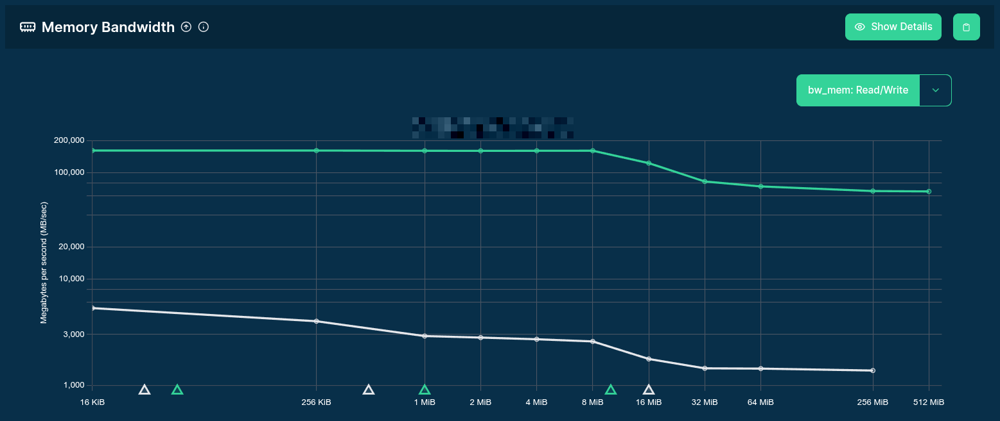{.r-stretch fig-align="center"}

<div class="slide-text-overlay fragment"><span>30-50x</span></div>

::: {.notes}
logarithmic scale

note that this is a syntethic tets

TODO Gergo speaker notes
:::

## {#vcpu-diff-2 .center}

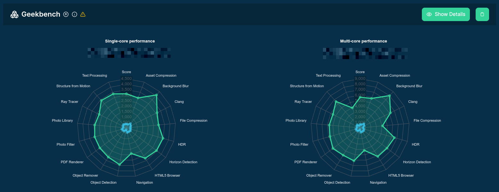{.r-stretch fig-align="center"}

<div class="slide-text-overlay fragment"><span>10-20x</span></div>

::: {.notes}
see Server A in the middle with scores around 500 across all dimensions?
so left hand side is single core, right hand side is multi core performance ... pretty much the same for Server A.

BUT Server B looking better: jumping from around 35 hundreds to 6000,
and in some workloads the diff between Server A and Server B are even larger.

TODO Gergo speaker notes
:::

## {#vcpu-diff-3 .center}

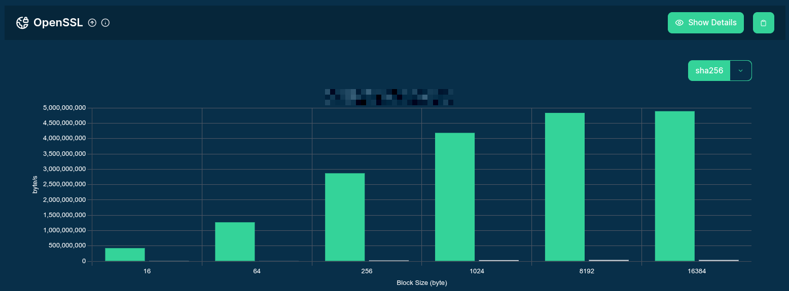{.r-stretch fig-align="center"}

<div class="slide-text-overlay fragment"><span>100x</span></div>

::: {.notes}
now this is not single-core anymore .. we run OpenSSL speed tests,
using various cipher and hash functions .. and Server A is hardly visible on this screen ..


TODO Gergo speaker notes
:::

## {#vcpu-diff-4 .center}

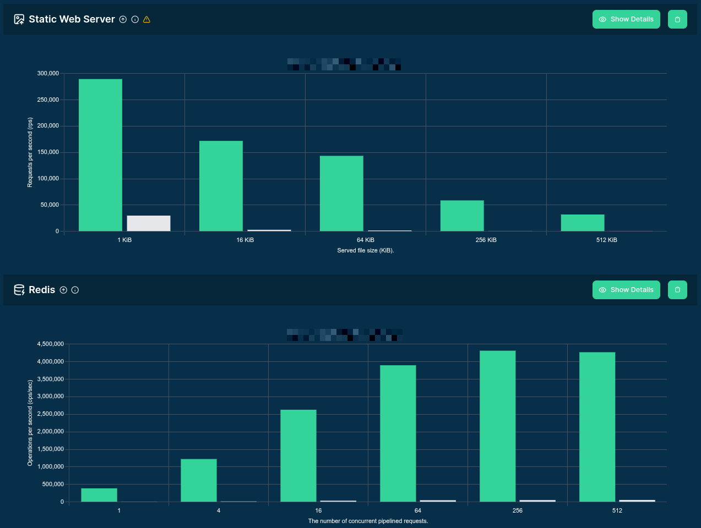{.r-stretch fig-align="center"}

<div class="slide-text-overlay fragment"><span>10-100x</span></div>

::: {.notes}
TODO Gergo speaker notes
:::

## {#vcpu-difference transition="slide-in slide-out"}  

::: {.notes}
Back to Vincent from Pulp Fiction .. who now looks even more confused.

Because it's possible that you get a 32 vCPU server, and your app that perfectly scales to multiple cores,
runs slower than on a single core of another cloud server type.
:::

::: {.centered}
<div style="position: relative; display: inline-block; margin-top: -45px;">
  
  <video autoplay muted loop playsinline data-autoplay
         src="images/vincent-confused.webm"
         style="position: absolute; left: 45%; bottom: 1.5%;
                transform: translateX(-50%); width: 50%;
                background: transparent; pointer-events: none;">
  </video>
</div>
:::

## {#vcpus-2-count .center}

::: {.notes}
And there's quite a spectrum even when just looking at the 2 vCPU options ...
Any guesses how many?

[...]

611 instance types with 2 vCPUs ... we monitor 8 vendors (logos on prior slide).

Click the chart to zoom out and reveal the answer.
:::

::: {.r-stretch}
<div class="vcpu-count-slide-content">
<div class="vcpu-count-wrapper">
  <object type="image/svg+xml"
          data="images/vcpu-2-count-chart.svg"
          class="r-stretch vcpu-count-chart"
          aria-label="Guess the number of 2 vCPU servers at the supported vendors. Click to reveal 611.">
  </object>
</div>

```{=html}
<div class="vendor-logos" aria-label="Supported cloud vendors (alphabetical)" style="margin-top: 60px;">
  <div class="vendor-logos-row">
    
    
    
    
  </div>
  <div class="vendor-logos-row">
    
    
    
    
  </div>
</div>
```

</div>
:::

<span class="fragment vcpu-count-zoom" data-fragment-index="1"></span>

<script>
  (function () {
    function initVcpuCountSlide() {
      var reveal = window.Reveal;
      var slide = document.getElementById('vcpus-2-count');
      if (!reveal || !slide) return false;
      if (slide.dataset.vcpuCountBound) return true;

      slide.dataset.vcpuCountBound = '1';

      function getChartSvg() {
        var obj = slide.querySelector('object.vcpu-count-chart');
        if (!obj || !obj.contentDocument) return null;
        return obj.contentDocument.getElementById('vcpu-count-chart');
      }

      function syncZoom() {
        var chart = getChartSvg();
        var fragment = slide.querySelector('.vcpu-count-zoom');
        if (!chart || !fragment) return;
        chart.classList.toggle('zoomed', fragment.classList.contains('visible'));
      }

      var obj = slide.querySelector('object.vcpu-count-chart');
      if (obj) {
        obj.addEventListener('load', syncZoom);
        if (obj.contentDocument) syncZoom();
      }

      reveal.on('fragmentshown', function (event) {
        if (event.fragment && event.fragment.classList.contains('vcpu-count-zoom')) syncZoom();
      });
      reveal.on('fragmenthidden', function (event) {
        if (event.fragment && event.fragment.classList.contains('vcpu-count-zoom')) syncZoom();
      });
      reveal.on('slidechanged', function (event) {
        if (event.currentSlide && event.currentSlide.id === 'vcpus-2-count') syncZoom();
      });

      window.addEventListener('message', function (event) {
        if (event.data && event.data.type !== 'vcpu-count-click') return;
        if (!slide.classList.contains('present')) return;
        var fragment = slide.querySelector('.vcpu-count-zoom');
        if (fragment && !fragment.classList.contains('visible')) reveal.nextFragment();
      });

      return true;
    }

    if (!initVcpuCountSlide()) {
      var tries = 0;
      var timer = setInterval(function () {
        if (initVcpuCountSlide() || ++tries > 50) clearInterval(timer);
      }, 100);
    }
  })();
</script>

<!-- TODO Gergo add a breakdown of 2 vCPU servers per vendor (AWS: 146) -->

# $ whois sparecores.com {#whois transition="convex-in convex-out"}

<ul style="font-size: 0.9em;">
  <li class="fragment" data-fragment-index=1>Funded by NGI Search (EU consortium) in 2024</li>
  <ul>
    <li class="fragment" data-fragment-index=1>Vendor independent, open-source project</li>
  </ul>
  <li class="fragment" data-fragment-index=2>Seal of Excellence from the European Commission in 2026</li>
  <li class="fragment" data-fragment-index=3>Accepted into NVIDIA Inception, AWS Open Source Credits</li>
  <li class="fragment" data-fragment-index=4>Beneficiary of cloud credits from 8 vendors (overall ~$100k)</li>
  <li class="fragment" data-fragment-index=5>20+ talks in 9 countries (e.g. Berlin Buzzwords, PyData, KCD)</li>
  <li class="fragment" data-fragment-index=6>Featured by The Pragmatic Engineer in Oct 2024</li>
  <li class="fragment" data-fragment-index=7>Jeff Barr (Chief Evangelist at AWS) on our Reddit post:</li>
</ul>

<blockquote class="fragment" data-fragment-index=7 style="margin-left: 40px;">
  This was awesome, thanks for sharing.
</blockquote>

::: {.notes}
first of all, just to build some credibility for the project:
we are committed to be vendor-agnostic, open-source, and transparent about our data
:::

# $ apropos sparecores.com {#apropos transition="convex-in convex-out"}

<ul style="font-size: 0.9em;">
  <li class="fragment">Open-source tools, database schemas and documentation to inspect and inventory cloud vendors and their offerings, including pricing and measured performance.</li>
  <li class="fragment">Managed infrastructure, databases, APIs, SDKs, and web applications to make this data publicly accessible.</li>
  <li class="fragment">Open-source helpers to select, start and manage instances in your own environment.</li>
  <li class="fragment">Open-source Python/R packages and workflow orchestration extensions (e.g. Metaflow) to track resource usage and cost of DS/ML/AI jobs. Open-source tooling to right-size instances.</li>
  <li class="fragment">Add-on services to scale data science workflows, even without direct vendor engagement.</li>
</ul>

::: {.notes}
- so Spare Cores is an open-source ecosystem, including software, database schemas, guides,
- and actual databases if you don't want to run the ETL tooling yourself .. also providing APIs, SDKs etc to make it easier to query data
- unified CLI to start machines
- and working on an an optional SaaS offering built on the top of the open-source tooling for folks who would rather avoid registering with all cloud providers etc: give us a Docker image, a command to run, and you credit card .. all set, we will run it wherever it's cheapest.
:::

## $ curl -I github.com/sparecores

::: {.centered}
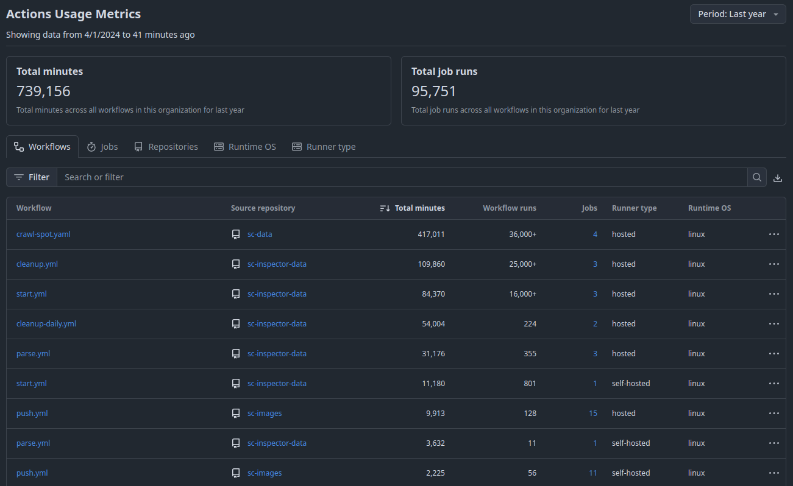
:::

<aside class="notes">
FTR this dataset was generated, collected, standardized, and published in public GHA if ou are interested in the details.
running around 100k jobs over 10k hours...
</aside>

## $ ls -1 sparecores {#components transition="convex-in convex-out"}

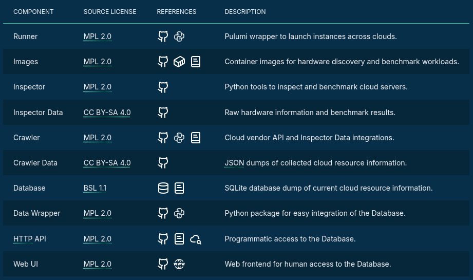

::: {.notes}
As mentioned previously, this is made available via multiple components that
you can find on GitHub. We don't have time to go through all of them, but
I'd be happy to answer any related questions on Slack, or ping me on LinkedIn :)

WE will focus on the inspector now!
:::

# $ curl -I sparecores.com/navigator {transition="convex-in slide-out"}

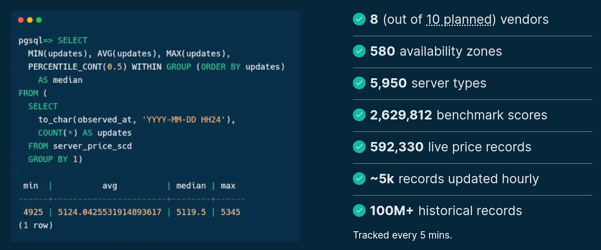

<p class="centered" style="margin-top: -10px;">Source: <a href="https://sparecores.com">sparecores.com</a></p>

::: {.notes}
high level numbers about the data we collect and make available
:::

::: {.notes}
A: wait, do I need to write SQL to query this data?
:::

# $ curl sparecores.com/servers

::: {.centered}
<a href="https://sparecores.com/servers" target="_blank">
  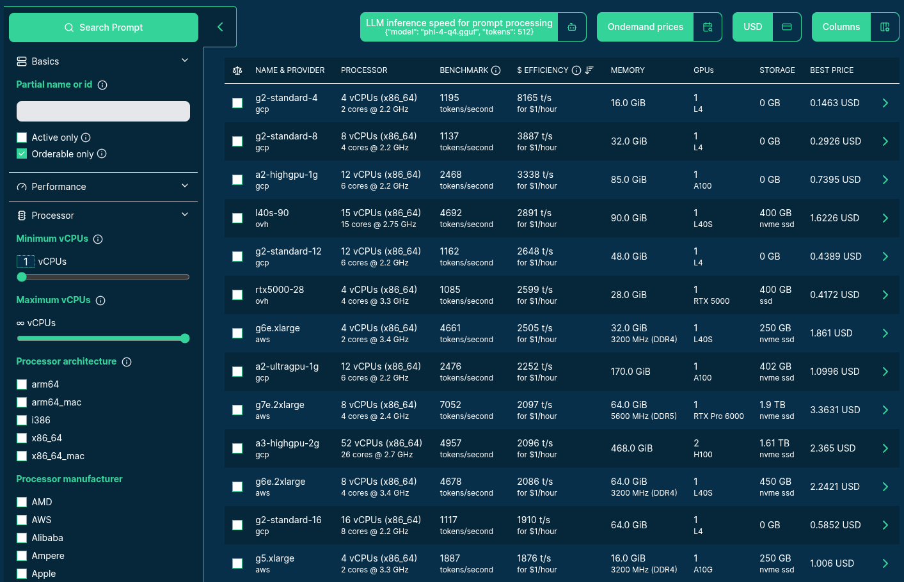
</a>
:::

::: {.notes}
The easiest way to query this data is through our web component, as you can see on the screen ...

G: What kind of server are we looking for?
A: min 2 vCPU, 16 GB RAM, AWS, Oregon
G: Any special network requirements? We track outbound traffic prices ...
A: No.
G: Anything else?
A: Single core performance is important for usage.
G: We support a bunch of benchmarks, e.g. PassMark CPU Single Threaded Test?
G: Let's order by performance then.
A: That metal server looks promising
G: Let's see the details ...

Check server details page. Scoll over the benchmarks.
- server metadata
- benchmarks 
- price diffs -> oops .. spot vs ondemand

G: Actually, it's $5 ondemand.
A: That's too much. The devops team picked r5a.large .. can we find something better around the same price?
G: ADVISOR!!
:::

<!-- TODO Gergo get lstopo on m8azn.metal-12xl -->

## $ curl sparecores.com/server/gcp/g2-standard-16

::: {.centered}
<a href="https://sparecores.com/server/gcp/g2-standard-16" target="_blank">
  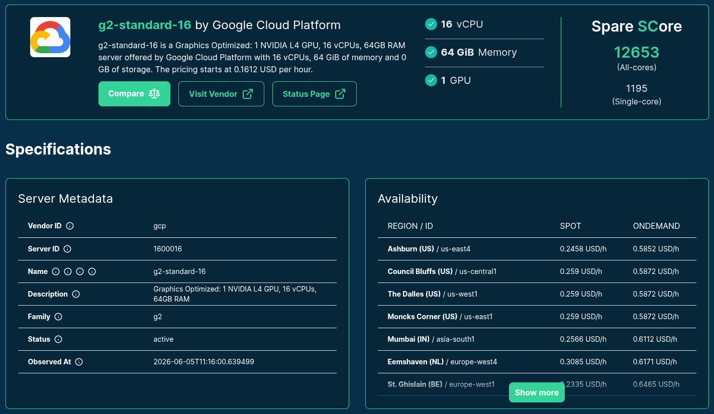
</a>
:::

::: {.notes}
Clicking on a server shows you the technical details of the instance -- much more than what's provided publicly by the vendor, even more than what ChatGPT knows ... as we actually start each machine and inspect the hardware.
:::

## $ curl sparecores.com/server/gcp/g2-standard-16

::: {.centered}
<a href="https://sparecores.com/server/gcp/g2-standard-16" target="_blank">
  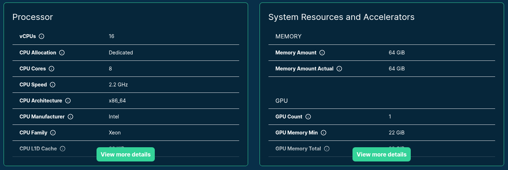
  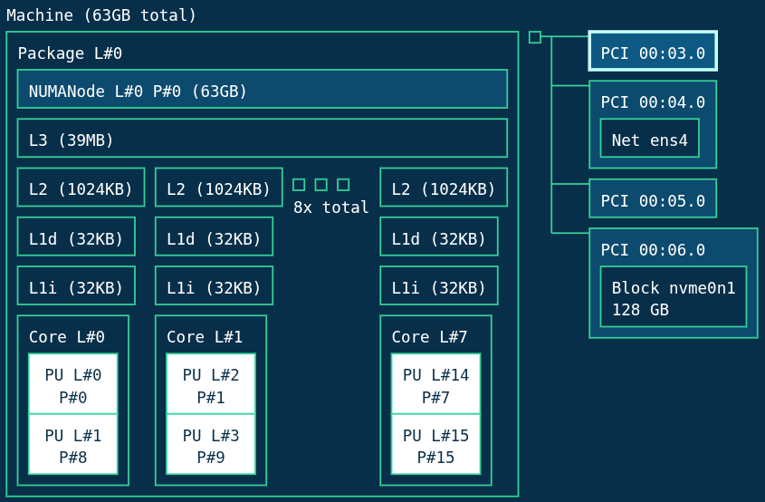
</a>
:::

## $ curl sparecores.com/server/gcp/g2-standard-16

::: {.centered}
<a href="https://sparecores.com/server/gcp/g2-standard-16" target="_blank">
  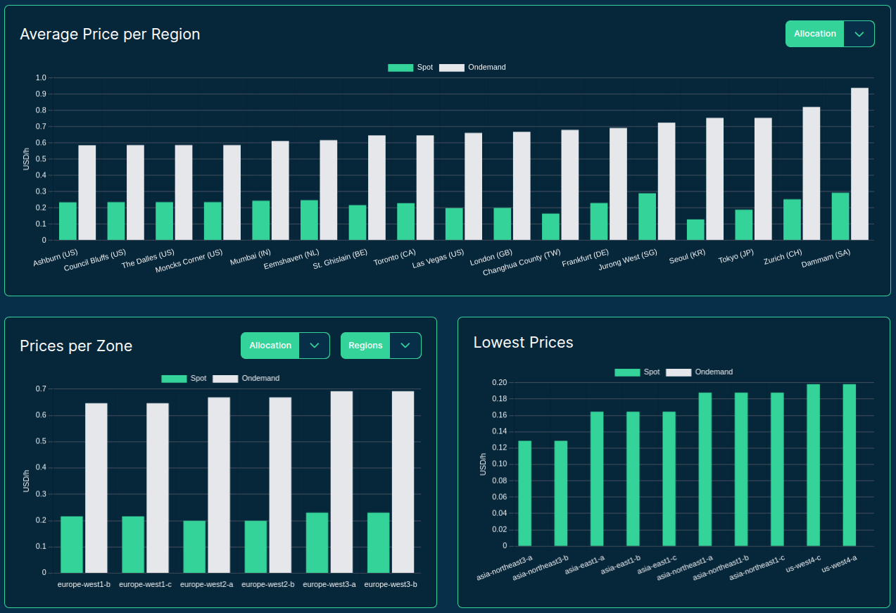
</a>
:::

::: {.notes}
Live and historical pricing
:::

## $ curl sparecores.com/server/gcp/g2-standard-16

<!--
<iframe
 src="https://sparecores.com/embed/server/gcp/g2-standard-16/bw_mem"
 style="height: 510px; width: 100%; border: 1px solid #34d399; border-radius: 8px; min-height: 400px">
</iframe>
-->

::: {.centered}
<a href="https://sparecores.com/server/gcp/g2-standard-16" target="_blank">
  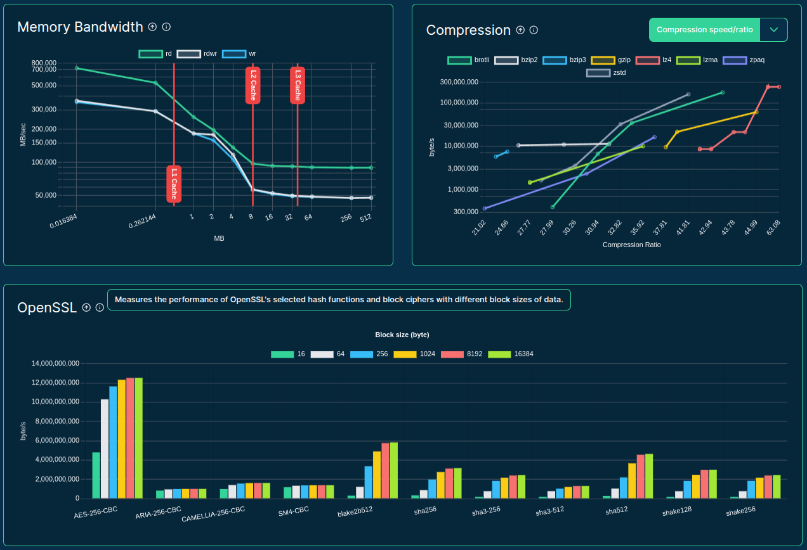
</a>
:::

::: {.notes}
and we also run benchmark scenarios on the servers, e.g.:

- memory bandwidth of read, write and mixed operations using various block sizes and also including the related L1/L2/L3 cache amounts
- or benchmarking compression algos - having the compression ratio on the x axis, and the bandwidth on the y axis, it's clear that `zpaq` is a beast when it comes to compressing text, but might be slow on this machine
- OpenSSL hash functions and block ciphers
:::

## $ curl sparecores.com/server/gcp/g2-standard-16

<a href="https://sparecores.com/server/gcp/g2-standard-16" target="_blank">
  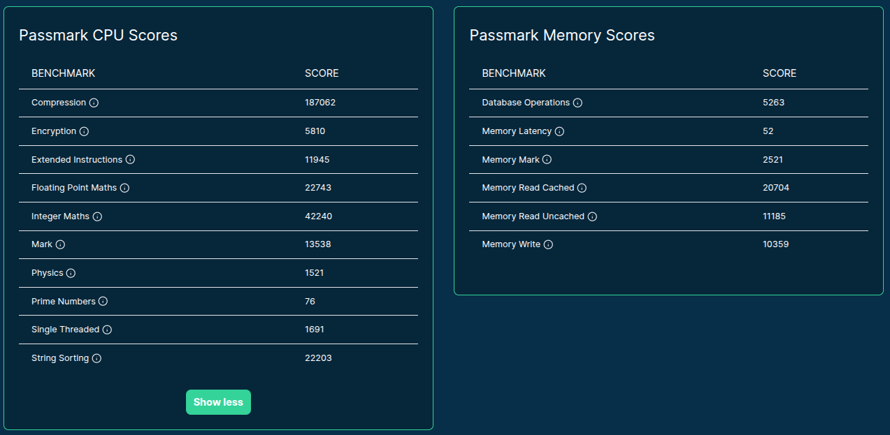
</a>

::: {.notes}
also running test suites like PassMark or ...
:::

## $ curl sparecores.com/server/gcp/g2-standard-16

<a href="https://sparecores.com/server/gcp/g2-standard-16" target="_blank">
  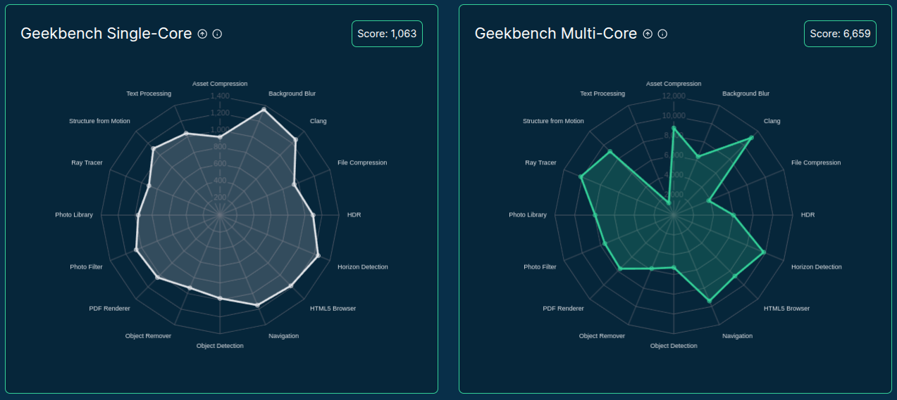
</a>

::: {.notes}
Geekbench 6, which has been a standard tool for some time including workloads for text and image processing, compiling software etc
:::

## $ curl sparecores.com/server/gcp/g2-standard-16

<a href="https://sparecores.com/server/gcp/g2-standard-16" target="_blank">
  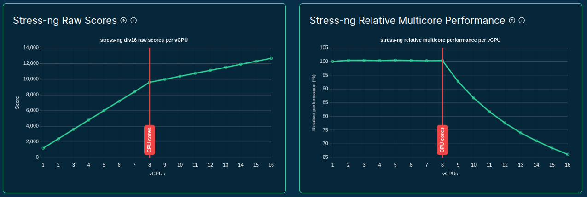
</a>

::: {.notes}
visualizations on how well the machine can scale tasks to multiple CPU cores -- e.g. showing the diminishing return on this Intel Xeon due to hyperthreading
:::

## $ curl sparecores.com/server/gcp/g2-standard-16

<a href="https://sparecores.com/server/gcp/g2-standard-16" target="_blank">
  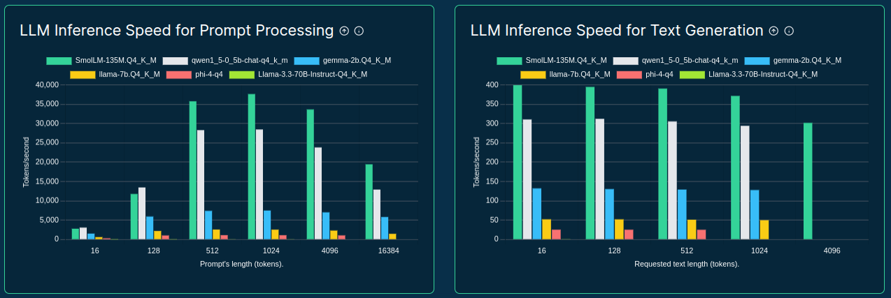
</a>

::: {.notes}
Or looking at LLM Inference Speed both for prompt processing and text generation,
using smaller models with 135M parameters up to 70B larger models.
:::

## >>> from navigator.www import server

<a href="https://sparecores.com/server/gcp/g2-standard-16" target="_blank">
  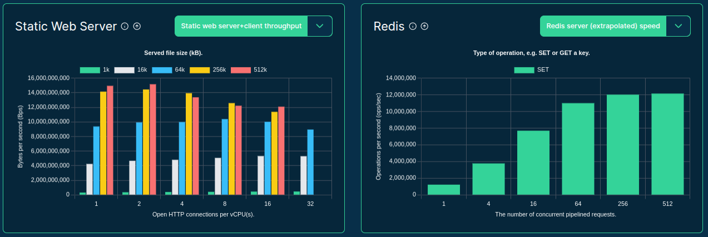
</a>

::: {.notes}
and other application-specific benchmarks, like serving a static website or running a key-value store database
:::

## $ curl sparecores.com/servers/compare

::: {.centered}
<a href="https://sparecores.com/compare?instances=W3sidmVuZG9yIjoiYXdzIiwic2VydmVyIjoiYzVhZC4xMnhsYXJnZSJ9LHsidmVuZG9yIjoiYXdzIiwic2VydmVyIjoiYzVkLjJ4bGFyZ2UifSx7InZlbmRvciI6ImF3cyIsInNlcnZlciI6ImM2Zy4xNnhsYXJnZSJ9LHsidmVuZG9yIjoiaGNsb3VkIiwic2VydmVyIjoiY2N4MzMifV0%3D" target="_blank">
  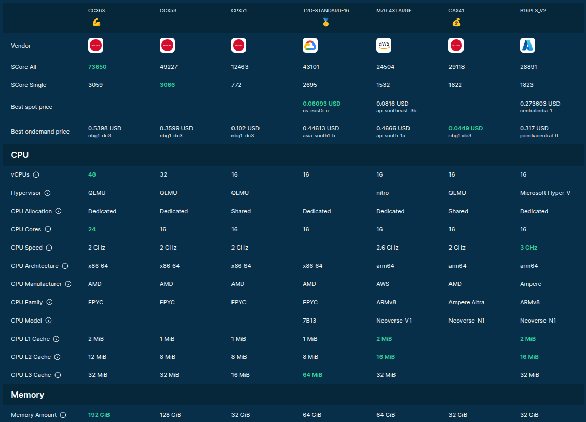
</a>
:::

::: {.notes}
and making all these data available in comparison tables,
e.g. you can see "Best performance servers for Redis below ¢50/hour" here
:::

## $ curl sparecores.com/servers/compare

::: {.centered}
<a href="https://sparecores.com/compare?instances=W3sidmVuZG9yIjoiYXdzIiwic2VydmVyIjoiYzVhZC4xMnhsYXJnZSJ9LHsidmVuZG9yIjoiYXdzIiwic2VydmVyIjoiYzVkLjJ4bGFyZ2UifSx7InZlbmRvciI6ImF3cyIsInNlcnZlciI6ImM2Zy4xNnhsYXJnZSJ9LHsidmVuZG9yIjoiaGNsb3VkIiwic2VydmVyIjoiY2N4MzMifV0%3D" target="_blank">
  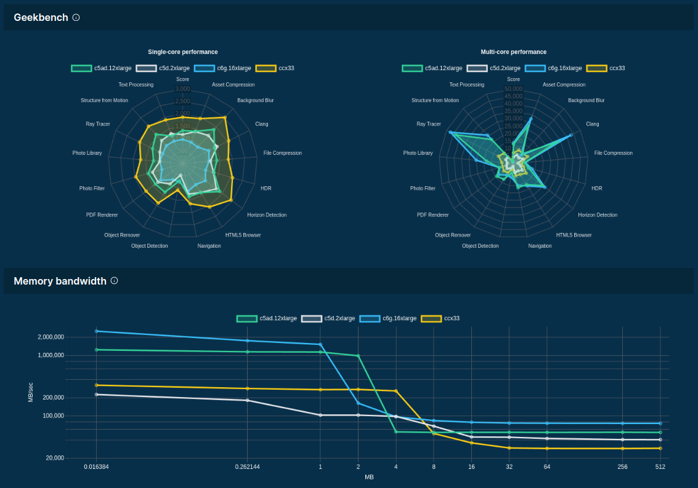
</a>
:::

::: {.notes}
or plots as well for human inspection
:::

# $ curl sparecores.com/advisor

<!-- TODO Gergo add advisor image and demo scenario for live walkthought

https://sparecores.com/advisor?vendor=aws&baseline_vendor=aws&baseline_server=r5a.large&limit_architecture=true&workload_id=stress_ng:best1&workload_config=%7B%7D&optimization_goal=cost-efficiency&avg_cpu_utilization=100&minimum_memory=16

https://sparecores.com/advisor?vendor=aws&vendor_regions=aws~us-west-2&baseline_vendor=aws&baseline_server=r5a.large&limit_architecture=true&workload_id=stress_ng:best1&workload_config=%7B%7D&optimization_goal=cost-efficiency&avg_cpu_utilization=100&minimum_memory=16
-->

::: {.notes}
r5a.large
"cpu_single_threaded_test"
AWS
Oregaon
ondemand price
TODO Gergo Marci ticket ne ugraljon az advisor a tetejere gombnyomasra
TODO Gergo Marci ticket bad best price https://sparecores.com/advisor?vendor_regions=aws~us-west-2&baseline_vendor=aws&baseline_server=r5a.large&workload_id=passmark:cpu_single_threaded_test&workload_config=%7B%7D&avg_cpu_utilization=100&minimum_memory=16&price_allocation_enabled=true&best_price_allocation=ONDEMAND_ONLY (wrong region?)


A: Can we query this in a programmatic way?
G: yes ...
:::

# $ curl docs.sparecores.com/api

<!-- TODO Gergo replace image with docs site -->

::: {.centered}
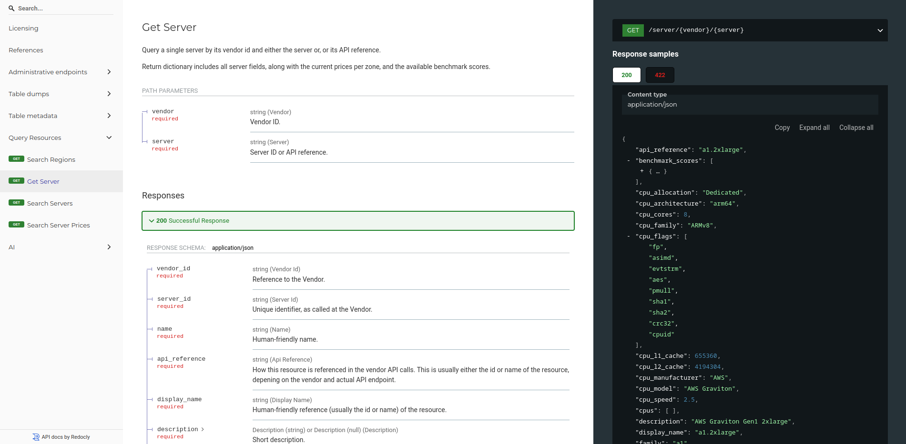
:::

::: {.notes}
for computers, we provide APIs ...

is it something you could use?
:::

# {#gilty}

::: {.centered}

:::

::: {.notes}
TODO Attila add speaker notes

- single core performance, GIL
- I've looked at the database and compared the performance of GILty with a few benchmarks to see which matches the best
:::

## {#gilty-and-friends}

::: {.centered}

:::

::: {.notes}
TODO Attila speaker notes

- GIL megkerulhetetlen
- we need to provide infra to make it faster
- using Spare Cores data in Karpenter?
- we called it "Core Alone"
:::

# $ strace -e environment gilty.py

<!-- TODO Attila describe the environment you run gilty.py -->

- EKS
- Karpenter
- EKS Auto mode

::: {.notes}
TODO Attila speaker notes
:::

# $ claude --plan "fix problem"

<!-- TODO Attila describe the controller spec draft -->


::: {.notes}
TODO Attila speaker notes
:::

# {#demo}

```{=html}
<link rel="stylesheet" href="https://cdn.jsdelivr.net/npm/asciinema-player@3.8.0/dist/bundle/asciinema-player.css" />
<div id="demo-player" style="width: 100%; height: 730px; margin-top: -30px;"></div>
<script src="https://cdn.jsdelivr.net/npm/asciinema-player@3.8.0/dist/bundle/asciinema-player.min.js"></script>
<script>
  (function () {
    const el = document.getElementById("demo-player");
    const player = AsciinemaPlayer.create(
      "casts/sc-karpenter-nodepool-demo.cast",
      el,
      { fit: "both", poster: "npt:0:6", preload: true }
    );
    // keep Space/arrows inside the player once clicked; clicker keys still navigate slides
    el.addEventListener("keydown", function (e) {
      if (e.key !== "PageDown" && e.key !== "PageUp") e.stopPropagation();
    });
    window.addEventListener("load", function () {
      Reveal.on("slidechanged", function () {
        player.pause();
        if (document.activeElement && el.contains(document.activeElement)) {
          document.activeElement.blur();
        }
      });
    });
  })();
</script>
```

::: {.notes}
TODO Attila speaker notes
:::

# $ strace -e environment sparecores.com

<!-- TODO Gergo find better title for this slide -->
<!-- TODO Gergo add mermaid diagram from docs.sparecores.com/overview -->

::: {.notes}
TODO Gergo add speaker notes

Gergo: this is cool .. we could definitely use something like this at spare cores
GH/Pulumit etc fajdalom .. schedule/stop/tasks.

I've checked Gardener, Container API ... did not find anything plug and play.

how to use your kubernetes controller for this?
:::

# ENTRYPOINT ["sc-karpenter-nodepool"]

<!-- TODO Attila describe the limitations -->

- single cloud only

. . .

- defined region

. . .

- needs karpenter installed

. . .

- needs EKS, GKE, AKS, etc.

::: {.notes}
TODO Attila speaker notes
:::

# $ cat sc-karpenter-nodepool/ROADMAP.md

<!-- TODO Attila describe the ideal stack -->

1. onprem kubernetes cluster

. . .

2. be akarunk huzni gcp-t, hetznert etc AKARMIT EKS, GKE, AKS nelkul

. . .

3. controller? operator? -> vendor API create vpc/storage/node + network + join cluster

::: {.notes}
TODO Attila speaker notes
:::

# {#feedback}

<!-- TODO Gergo one question to the community of the would find something like this useful before we jump the rabbit hole to prepare for next year's KCD Budapest --> 

::: {.notes}
TODO Gergo speaker notes
:::

# Bye

<!-- TODO Gergo add thanks slide -->

<!--toggle visibility of items in live mode-->
<script>
var url = document.location.href;
if (url.match("/?live")) {
  const elements = document.getElementsByClassName('offlineMode');
  for (let i = 0; i < elements.length; i++) {
    element = elements.item(i);
    element.style.display = 'none';
  }
} else {
  const elements = document.getElementsByClassName('onlineMode');
  for (let i = 0; i < elements.length; i++) {
    element = elements.item(i);
    element.style.display = 'none';
  }
}
</script>
