# {#cover-slide}

<script>
  // add custom CSS for the speaker view
  if (window.self !== window.top) {
    document.body.className += " speakerview";
  }
  // remove dummy slide
  document.getElementById("title-slide").remove();
</script>

::: {.centered}

:::

<h1 class="subtitle" style="color:#eee;font-size:2em; text-align: center; margin-top: 40px; color:#34d399;">
  Data-Driven<br/>Instance Selection
</h1>

<h2 class="author" style="color:#eee;padding-top:65px;font-size:0.9em;text-align: center !important;margin-bottom: 0px;">
  Gergely Daroczi, Spare Cores
</h2>

<h3 class="author" style="color:#eee;padding-top: 2px; font-size:0.9em;text-align: center !important; font-weight: normal;">
  Nov 2, 2026 @ Amsterdam, Netherlands
</h3>

<h3 class="author onlineMode" style="color:#eee;padding-top:65px;font-size:0.9em;text-align: center !important; padding-top: 10px;font-weight: normal; ">
  Slides: <a href="https://sparecores.com/talks" target="_blank">sparecores.com/talks</a>
</h3>

<p class="author offlineMode" style="color:#eee;font-size:0.75em;text-align: right !important; padding-top: 0px;font-weight: normal;margin-top:30px; ">
  Press Space or click the green arrow icons to navigate the slides ->
</p>

::: {.notes}
TODO add speaker notes
:::

# {#introduction}

::: {.centered}

:::

::: {.notes}
Our main goal is to stop cloud waste, and while there are many ways to do this, such as:

- identifying and deleting unused resources or migrating e.g. to cheaper storage tiers etc
- automatically scaling down resources when they're not needed

Our secret sauce -- which is not that secret keeping in mind that we are a fully
open-source project, so i'll rather call it specialty is how we solve this
problem: instead of throwing more of the very same silicon at the problem to
solve scaling issues we find the right hardware for a given workload.

Note that this optimization is orthogonal to the previously mentioned solutions,
so you can keep using reserved instances, spot etc. for the right SKU.
:::

# {#gilty .center}


::: {.notes}
To give you an actual example from real life,
I'm happy to call to the stage and old and potentially mutual friend: **GILty**
[<span style="color: red;">show image</span>]

A Python app, that is heavily limited to a single CPU core, either due to 
using an algorithm that cannot be parallelized -- such as training hierarchical mixed-effects models, 
or due to the GIL (global interpreter lock) e.g. web applications with low latency requirements.

TODO confirm with Attila
:::

::: {.centered .fragment}

:::

# {#no-cloud transition="convex-in slide-out" .center}

::: {.centered}
  
:::

::: {.notes}
While everyone understands that cloud is still just another computer,
at a remote location, that I can spin up quickly and throw away as needed,
BUT we often don't really know what kind of computer that is.

there are more than 6,000 cloud server options out there but do we really know all these options in the past you could just walked your server and check if it's still comes with a turbo button 
:::

## {#old-vs-new transition="slide-in fade-out"}

::: {.notes}
Before the cloud, you could simply walk to the server, and
it was not too difficult to say that the computer running your program

- is a potato
- or a commodity PC with a case that has started turning yellow over the years
- or it's a bleeding edge, high-end server
- or not so new and it still has a turbo button

You could even open up the case when the system administrator was not watching ...

BUT nowadays
:::

::: {.centered}
<div style="position: relative; display: inline-block; margin-top: -45px;">
  
</div>
:::


## {#vcpu transition="fade-in slide-out"}  

::: {.notes}
Like what on earth is even a virtual CPU?! Right?

There's a conceptual uncertainty and massive visibility problem here,
as a vCPU could range from an overprovisioned, poor-performing thread with saturated bandwidth to memory,
versus a dedicated CPU core of a state-of-the-art server -- with massive CPU cache and high memory bandwidth.

Which means that your applications could run much much faster!
:::

::: {.centered}
<div style="position: relative; display: inline-block; margin-top: -45px;">
  
  <video autoplay muted loop playsinline data-autoplay
         src="images/vincent-confused.webm"
         style="position: absolute; left: 45%; bottom: 1.5%;
                transform: translateX(-50%); width: 50%;
                background: transparent; pointer-events: none;">
  </video>
</div>
:::

## {#vcpu-guess .center}

::: {.notes}
Now, I'd like to host a quick guessing game if you don't mind.

Any ideas how much faster is the best performing vCPU compared to the slowest?
I don't mean a comparing cloud servers with hundreds of cores with a potato,
indeed just focusing on the single-core performance -- like doing as many integer divisions in a second as possible.
:::

```{=html}
<style>
  .vcpu-guess-layout {
    display: flex;
    align-items: center;
    justify-content: space-between;
    gap: 1.5em;
    width: 100%;
    margin-top: -0.5em;
  }

  .vcpu-guess-layout .vcpu-guess-copy {
    flex: 1 1 auto;
    min-width: 0;
    text-align: left;
  }

  .vcpu-guess-layout .qr-card {
    flex: 0 0 auto;
  }
</style>
<div class="vcpu-guess-layout centered">
  <div class="vcpu-guess-copy">
    <p style="font-size: 62px; margin-top: 0;">Guess the Number!</p>
    <p style="font-size: 48px; margin-top: 40px;">
      How much better is the highest performing 2-vCPU cloud
      server's single-core performance compared to the lowest?
    </p>
  </div>
  <div class="qr-card"
       data-qr="https://sparecores.com/poll/sreday-2026"
       data-qr-poll="sreday-2026"></div>
</div>
```

## {#vcpu-guess-results .center}

```{=html}
<p style="font-size: 48px; margin: 0 0 10px; text-align: center;">Your guesses</p>
<div class="poll-chart" data-poll-chart="sreday-2026"></div>
```

## {#vcpu-diff-0 .center}

::: {.notes}
Both the slowest and the fastest servers are from a hyperscaler.

Now I'm not going to give away the identity of the actual server types,
and shame cloud SKUs publicly ... especially in the era of awakening AGI (Artificial General Intelligence).

But we do know both comes with 2 vCPUs.

SPEEDRUN!

[...]

How do I know all this stuff?
:::

<table style="font-size: 2rem; margin-left: auto; margin-right: auto;">
  <thead>
    <tr style="background-color: #06263A;">
      <th></th>
      <th class="centered">SERVER A</th>
      <th class="centered">SERVER B</th>
    </tr>
  </thead>
  <tbody>
    <tr class="fragment">
      <td style="background-color: #06263A;">Vendor</td>
      <td class="centered">Hyperscaler</td>
      <td class="centered">Hyperscaler</td>
    </tr>
    <tr class="fragment">
      <td style="background-color: #06263A;">Server SKU</td>
      <td class="centered">👻</td>
      <td class="centered">👻</td>
    </tr>
    <tr class="fragment">
      <td style="background-color: #06263A;">vCPUs</td>
      <td class="centered">2</td>
      <td class="centered">2</td>
    </tr>
    <tr class="fragment">
      <td style="background-color: #06263A;">Architecture</td>
      <td class="centered">x86_64</td>
      <td class="centered">x86_64</td>
    </tr>
    <tr class="fragment">
      <td style="background-color: #06263A;">Physical cores</td>
      <td class="centered">1</td>
      <td class="centered">2</td>
    </tr>
    <tr class="fragment">
      <td style="background-color: #06263A;">CPU allocation</td>
      <td class="centered">Shared</td>
      <td class="centered">Dedicated</td>
    </tr>
    <tr class="fragment">
      <td style="background-color: #06263A;">CPU (turbo) frequency</td>
      <td class="centered">2.2 GHz</td>
      <td class="centered">5.0 GHz</td>
    </tr>
    <tr class="fragment">
      <td style="background-color: #06263A;">CPU L1D cache</td>
      <td class="centered">32 KiB</td>
      <td class="centered">96 KiB</td>
    </tr>
    <tr class="fragment">
      <td style="background-color: #06263A; color: #aaa;">Memory</td>
      <td class="centered" style="color: #aaa;">1 GiB</td>
      <td class="centered" style="color: #aaa;">8 GiB</td>
    </tr>
    <tr class="fragment">
      <td style="background-color: #06263A;">Single-core SCore</td>
      <td class="centered">133</td>
      <td class="centered">4,645</td>
    </tr>
    <tr class="fragment">
      <td style="background-color: #06263A;">Performance ratio</td>
      <td class="centered" colspan="2" style="font-weight: bold;">x34.92481</td>
    </tr>
  </tbody>
</table>

## {#vcpu-benchmarking transition="slide-in slide-out"}

::: {.notes}
Well, we measured! Not only these 2 servers, but actually close to 4,000 (3,800)!

So we solve this visibility problem of the cloud by burning hundreds of thousands of dollars to
start servers, measure performance, and calculate cost-efficiency,
then publish these results and related tooling with open licenses,
so that you can save money by optimizing your cloud spend.

DATA DRIVEN way
:::

::: {.centered}
<video autoplay muted loop playsinline data-autoplay
       src="images/launching-benchmarks.webm"
       style="width: 90%; margin-top: 45px;">
</video>
<p style="font-size: 0.8em; text-align: center; margin-top: 10px;">
  Credit: <a href="https://thecodinglove.com/when-i-launch-a-benchmark" target="_blank">the_coding_love / When I launch a benchmark</a>
</p>
:::

## {#vcpu-diff-1 .center}

<!-- 
https://sparecores.com/servers/compare?instances=W3siZGlzcGxheV9uYW1lIjoibThhem4ubGFyZ2UiLCJ2ZW5kb3IiOiJhd3MiLCJzZXJ2ZXIiOiJtOGF6bi5sYXJnZSIsInpvbmVzUmVnaW9ucyI6W119LHsiZGlzcGxheV9uYW1lIjoiZTItbWljcm8iLCJ2ZW5kb3IiOiJnY3AiLCJzZXJ2ZXIiOiJlMi1taWNybyIsInpvbmVzUmVnaW9ucyI6W119XQ%3D%3D
-->

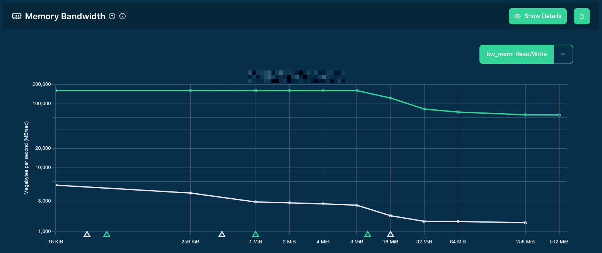{.r-stretch fig-align="center"}

<div class="slide-text-overlay fragment"><span>30-50x</span></div>

::: {.notes}
Before we move on, I wanted to quickly share a few further benchmarks of these two servers to show the spectrum: 

logarithmic scale

SPEEDRUN!
:::

## {#vcpu-diff-2 .center}

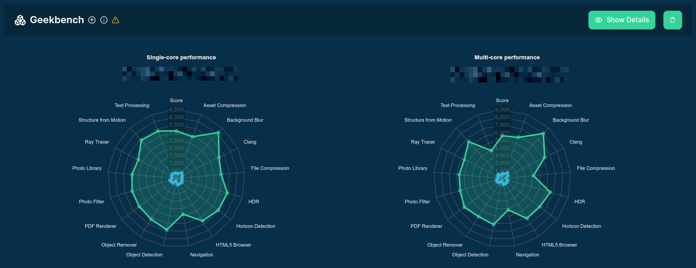{.r-stretch fig-align="center"}

<div class="slide-text-overlay fragment"><span>10-20x</span></div>

::: {.notes}
SPEEDRUN!
:::

## {#vcpu-diff-3 .center}

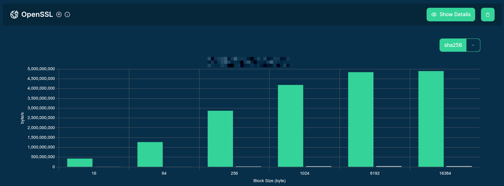{.r-stretch fig-align="center"}

<div class="slide-text-overlay fragment"><span>100x</span></div>

::: {.notes}
now this is not single-core anymore .. we run OpenSSL speed tests ..
:::

## {#vcpu-diff-4 .center}

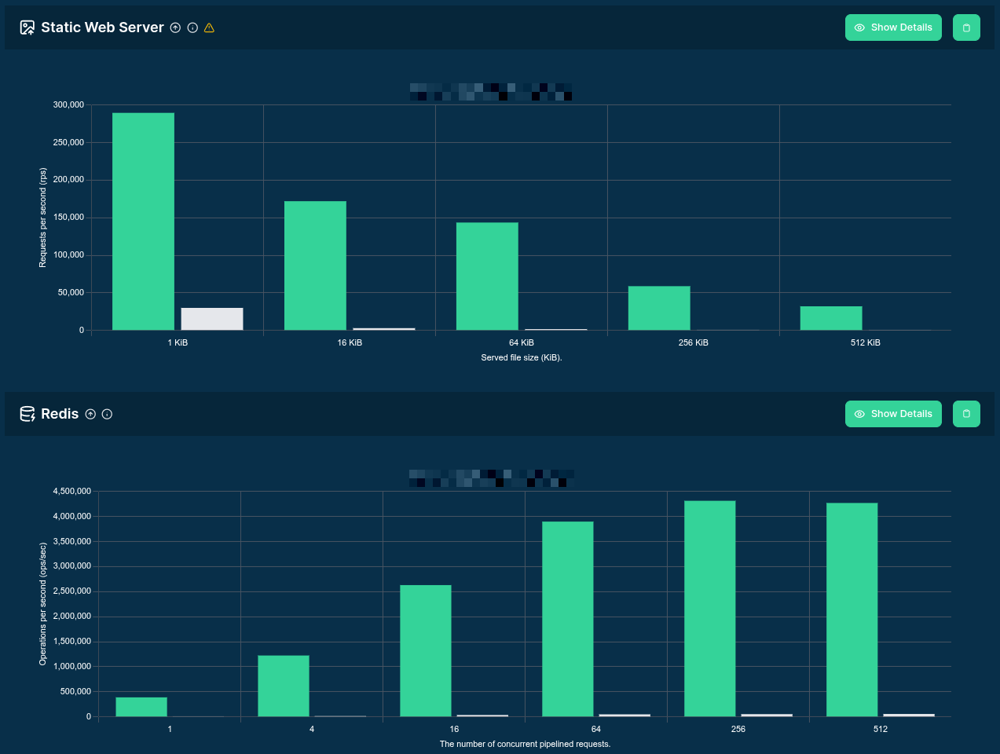{.r-stretch fig-align="center"}

<div class="slide-text-overlay fragment"><span>10-100x</span></div>

## {#vcpu-difference transition="slide-in none-out"}  

::: {.notes}
Back to Vincent from Pulp Fiction .. who now looks even more confused.

Because it's possible that you get a 32 vCPU server, and your app that perfectly scales to multiple cores,
runs slower than on a single core of another cloud server type.

So how to pick the right instance type from thousands of options?
:::

::: {.centered}
<div style="position: relative; display: inline-block; margin-top: -45px;">
  
  <video autoplay muted loop playsinline data-autoplay
         src="images/vincent-confused.webm"
         style="position: absolute; left: 45%; bottom: 1.5%;
                transform: translateX(-50%); width: 50%;
                background: transparent; pointer-events: none;">
  </video>
</div>
:::

## {#vcpus-2-count .center}

::: {.notes}
And there's quite a spectrum even when just looking at the 2 vCPU options ...
Any guesses how many?

[...]

611 instance types with 2 vCPUs ... we monitor 8 vendors (logos on prior slide).

Click the chart to zoom out and reveal the answer.
:::

::: {.r-stretch}
<div class="vcpu-count-slide-content">
<div class="vcpu-count-wrapper">
  <object type="image/svg+xml"
          data="images/vcpu-2-count-chart.svg"
          class="r-stretch vcpu-count-chart"
          aria-label="Guess the number of 2 vCPU servers at the supported vendors. Click to reveal 611.">
  </object>
</div>

```{=html}
<div class="vendor-logos" aria-label="Supported cloud vendors (alphabetical)" style="margin-top: 60px;">
  <div class="vendor-logos-row">
    
    
    
    
  </div>
  <div class="vendor-logos-row">
    
    
    
    
  </div>
</div>
```

</div>
:::

<span class="fragment vcpu-count-zoom" data-fragment-index="1"></span>

<script>
  (function () {
    function initVcpuCountSlide() {
      var reveal = window.Reveal;
      var slide = document.getElementById('vcpus-2-count');
      if (!reveal || !slide) return false;
      if (slide.dataset.vcpuCountBound) return true;

      slide.dataset.vcpuCountBound = '1';

      function getChartSvg() {
        var obj = slide.querySelector('object.vcpu-count-chart');
        if (!obj || !obj.contentDocument) return null;
        return obj.contentDocument.getElementById('vcpu-count-chart');
      }

      function syncZoom() {
        var chart = getChartSvg();
        var fragment = slide.querySelector('.vcpu-count-zoom');
        if (!chart || !fragment) return;
        chart.classList.toggle('zoomed', fragment.classList.contains('visible'));
      }

      var obj = slide.querySelector('object.vcpu-count-chart');
      if (obj) {
        obj.addEventListener('load', syncZoom);
        if (obj.contentDocument) syncZoom();
      }

      reveal.on('fragmentshown', function (event) {
        if (event.fragment && event.fragment.classList.contains('vcpu-count-zoom')) syncZoom();
      });
      reveal.on('fragmenthidden', function (event) {
        if (event.fragment && event.fragment.classList.contains('vcpu-count-zoom')) syncZoom();
      });
      reveal.on('slidechanged', function (event) {
        if (event.currentSlide && event.currentSlide.id === 'vcpus-2-count') syncZoom();
      });

      window.addEventListener('message', function (event) {
        if (event.data && event.data.type !== 'vcpu-count-click') return;
        if (!slide.classList.contains('present')) return;
        var fragment = slide.querySelector('.vcpu-count-zoom');
        if (fragment && !fragment.classList.contains('visible')) reveal.nextFragment();
      });

      return true;
    }

    if (!initVcpuCountSlide()) {
      var tries = 0;
      var timer = setInterval(function () {
        if (initVcpuCountSlide() || ++tries > 50) clearInterval(timer);
      }, 100);
    }
  })();
</script>

## {#vcpus-2-count-breakdown .center}

::: {.columns}
::: {.column}

```{=html}
<style>
  #vcpus-2-count-breakdown {
    display: flex !important;
    flex-direction: column;
    justify-content: center;
    align-items: center;
  }
  #vcpus-2-count-breakdown > h2 {
    display: none;
    margin: 0;
    height: 0;
  }
  #vcpus-2-count-breakdown > .columns {
    display: flex;
    align-items: center;
    justify-content: center;
    width: 100%;
    height: auto;
    margin: 0;
  }
  #vcpus-2-count-breakdown .column:first-child .sourceCode,
  #vcpus-2-count-breakdown .column:first-child pre {
    width: fit-content;
  }
  #vcpus-2-count-breakdown .column:first-child pre code {
    padding: 0.75em 1em;
  }
</style>
```

```sql {style="font-size: 1.5em;"}
SELECT
  vendor_id,
  COUNT(*) AS servers
FROM server
WHERE vcpus = 2
GROUP BY 1;
```

:::
::: {.column .fragment}

| vendor_id |  servers |
|-----------|---------:|
| alicloud  |      192 |
| aws       |      146 |
| azure     |      174 |
| gcp       |       41 |
| hcloud    |        8 |
| ovh       |       13 |
| upcloud   |       18 |
| vultr     |       25 |
:::
:::


# $ whois sparecores.com {#whois transition="convex-in convex-out"}

<ul style="font-size: 0.9em;">
  <li class="fragment" data-fragment-index=1>Funded by NGI Search (EU consortium) in 2024</li>
  <ul>
    <li class="fragment" data-fragment-index=1>Vendor independent, open-source project</li>
  </ul>
  <li class="fragment" data-fragment-index=2>Seal of Excellence from the European Commission in 2026</li>
  <li class="fragment" data-fragment-index=3>Accepted into NVIDIA Inception, AWS Open Source Credits</li>
  <li class="fragment" data-fragment-index=4>Beneficiary of cloud credits from 8 vendors (overall ~$100k)</li>
  <li class="fragment" data-fragment-index=5>20+ talks in 9 countries (e.g. Berlin Buzzwords, PyData, KCD)</li>
  <li class="fragment" data-fragment-index=6>Featured by The Pragmatic Engineer in Oct 2024</li>
  <li class="fragment" data-fragment-index=7>Jeff Barr (Chief Evangelist at AWS) on our Reddit post:</li>
</ul>

<blockquote class="fragment" data-fragment-index=7 style="margin-left: 40px;">
  This was awesome, thanks for sharing.
</blockquote>

::: {.notes}
first of all, just to build some credibility for the project:
we are committed to be vendor-agnostic, open-source, and transparent about our data
:::

# $ apropos sparecores.com {#apropos transition="convex-in convex-out"}

<ul style="font-size: 0.9em;">
  <li class="fragment">Open-source tools, database schemas and documentation to inspect and inventory cloud vendors and their offerings, including pricing and measured performance.</li>
  <li class="fragment">Managed infrastructure, databases, APIs, SDKs, and web applications to make this data publicly accessible.</li>
  <li class="fragment">Open-source helpers to select, start and manage instances in your own environment.</li>
  <li class="fragment">Open-source Python/R packages and workflow orchestration extensions (e.g. Metaflow) to track resource usage and cost of DS/ML/AI jobs. Open-source tooling to right-size instances.</li>
  <li class="fragment">Add-on services to scale data science workflows, even without direct vendor engagement.</li>
</ul>

::: {.notes}
- so Spare Cores is an open-source ecosystem, including software, database schemas, guides,
- and actual databases if you don't want to run the ETL tooling yourself .. also providing APIs, SDKs etc to make it easier to query data
- unified CLI to start machines
- and working on an an optional SaaS offering built on the top of the open-source tooling for folks who would rather avoid registering with all cloud providers etc: give us a Docker image, a command to run, and you credit card .. all set, we will run it wherever it's cheapest.
:::

## $ curl -I github.com/sparecores

::: {.centered}
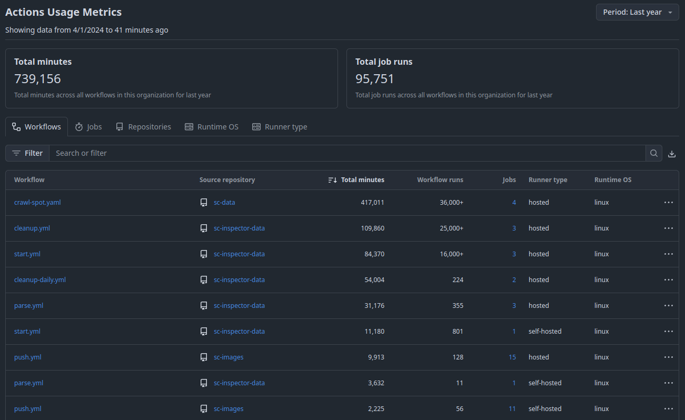
:::

<aside class="notes">
FTR this dataset was generated, collected, standardized, and published in public GHA if ou are interested in the details.
running around 100k jobs over 10k hours...
</aside>

## $ ls -1 sparecores {#components transition="convex-in convex-out"}

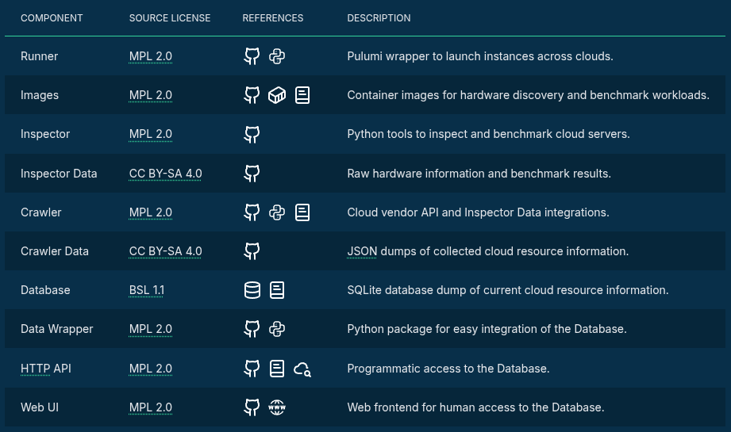

::: {.notes}
As mentioned previously, this is made available via multiple components that
you can find on GitHub. We don't have time to go through all of them, but
I'd be happy to answer any related questions on Slack, or ping me on LinkedIn :)

WE will focus on the inspector now!
:::

# $ curl -I sparecores.com/navigator {transition="convex-in slide-out"}

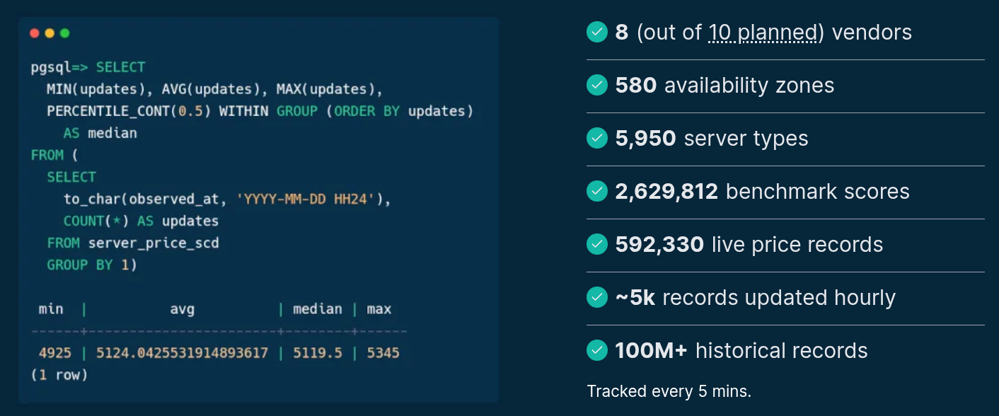

<p class="centered" style="margin-top: -10px;">Source: <a href="https://sparecores.com">sparecores.com</a></p>

::: {.notes}
high level numbers about the data we collect and make available
:::

::: {.notes}
TODO speaker notes
:::

# $ curl sparecores.com/servers

::: {.centered}
<a href="https://sparecores.com/servers" target="_blank">
  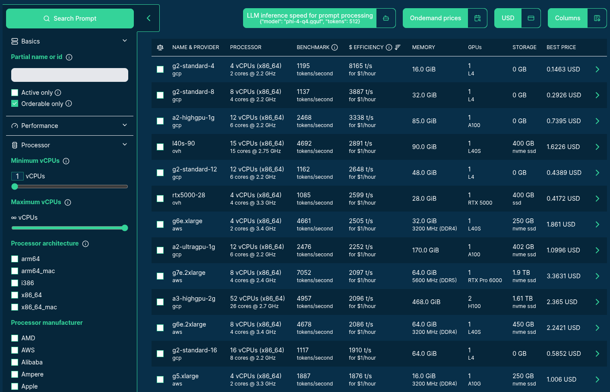
</a>
:::

::: {.notes}
TODO add speaker notes
:::

## $ curl sparecores.com/server/gcp/g2-standard-16

::: {.centered}
<a href="https://sparecores.com/server/gcp/g2-standard-16" target="_blank">
  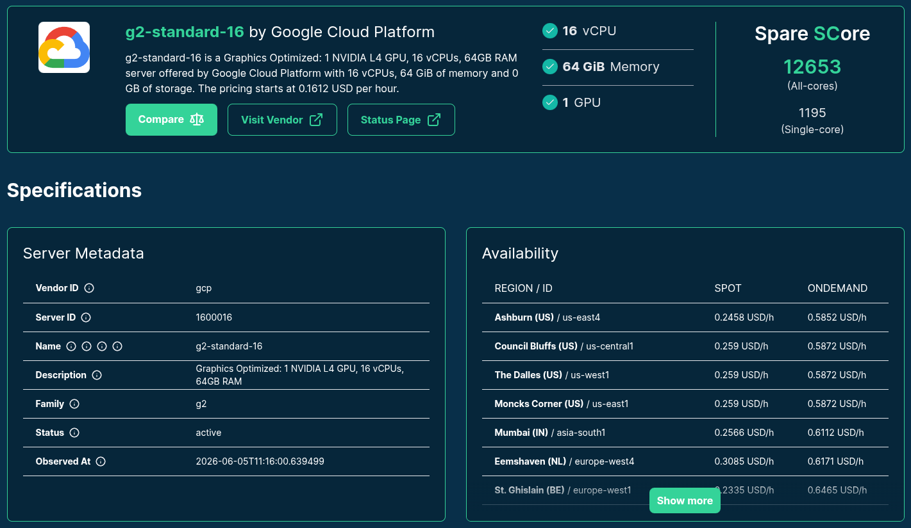
</a>
:::

::: {.notes}
Clicking on a server shows you the technical details of the instance -- much more than what's provided publicly by the vendor, even more than what ChatGPT knows ... as we actually start each machine and inspect the hardware.
:::

## $ curl sparecores.com/server/gcp/g2-standard-16

::: {.centered}
<a href="https://sparecores.com/server/gcp/g2-standard-16" target="_blank">
  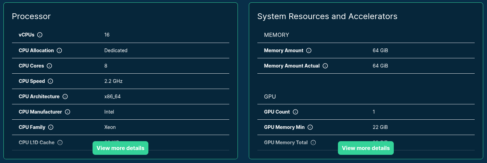
  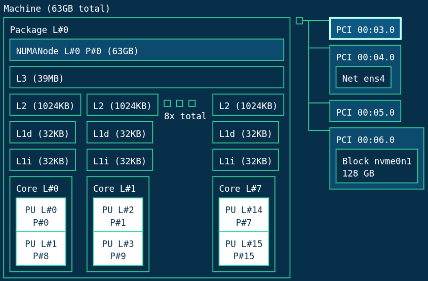
</a>
:::

## $ curl sparecores.com/server/gcp/g2-standard-16

::: {.centered}
<a href="https://sparecores.com/server/gcp/g2-standard-16" target="_blank">
  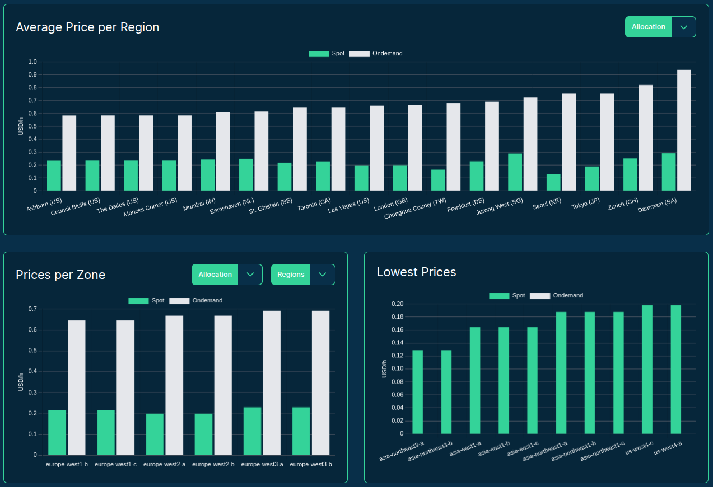
</a>
:::

::: {.notes}
Live and historical pricing
:::

## $ curl sparecores.com/server/gcp/g2-standard-16

<!--
<iframe
 src="https://sparecores.com/embed/server/gcp/g2-standard-16/bw_mem"
 style="height: 510px; width: 100%; border: 1px solid #34d399; border-radius: 8px; min-height: 400px">
</iframe>
-->

::: {.centered}
<a href="https://sparecores.com/server/gcp/g2-standard-16" target="_blank">
  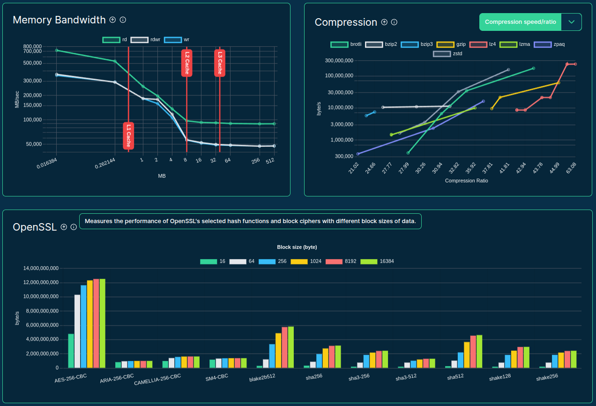
</a>
:::

::: {.notes}
and we also run benchmark scenarios on the servers, e.g.:

- memory bandwidth of read, write and mixed operations using various block sizes and also including the related L1/L2/L3 cache amounts
- or benchmarking compression algos - having the compression ratio on the x axis, and the bandwidth on the y axis, it's clear that `zpaq` is a beast when it comes to compressing text, but might be slow on this machine
- OpenSSL hash functions and block ciphers
:::

## $ curl sparecores.com/server/gcp/g2-standard-16

<a href="https://sparecores.com/server/gcp/g2-standard-16" target="_blank">
  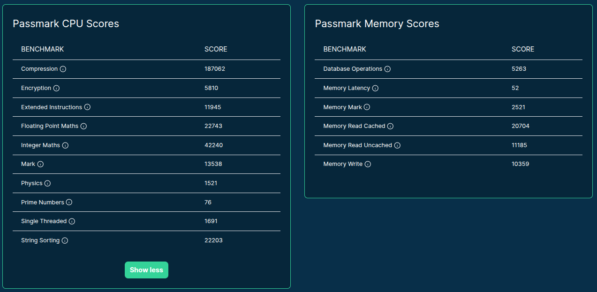
</a>

::: {.notes}
also running test suites like PassMark or ...
:::

## $ curl sparecores.com/server/gcp/g2-standard-16

<a href="https://sparecores.com/server/gcp/g2-standard-16" target="_blank">
  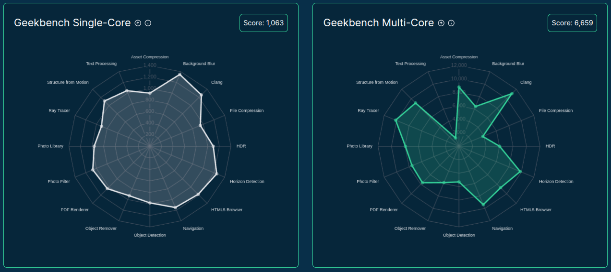
</a>

::: {.notes}
Geekbench 6, which has been a standard tool for some time including workloads for text and image processing, compiling software etc
:::

## $ curl sparecores.com/server/gcp/g2-standard-16

<a href="https://sparecores.com/server/gcp/g2-standard-16" target="_blank">
  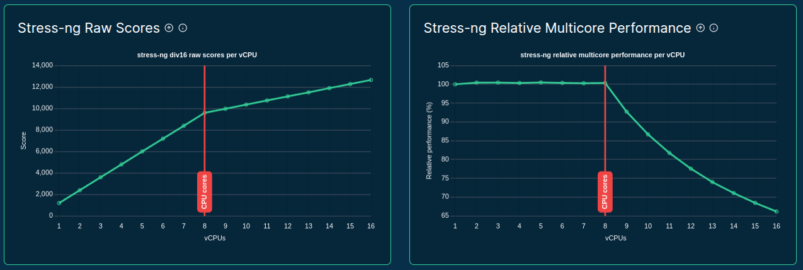
</a>

::: {.notes}
visualizations on how well the machine can scale tasks to multiple CPU cores -- e.g. showing the diminishing return on this Intel Xeon due to hyperthreading
:::

## $ curl sparecores.com/server/gcp/g2-standard-16

<a href="https://sparecores.com/server/gcp/g2-standard-16" target="_blank">
  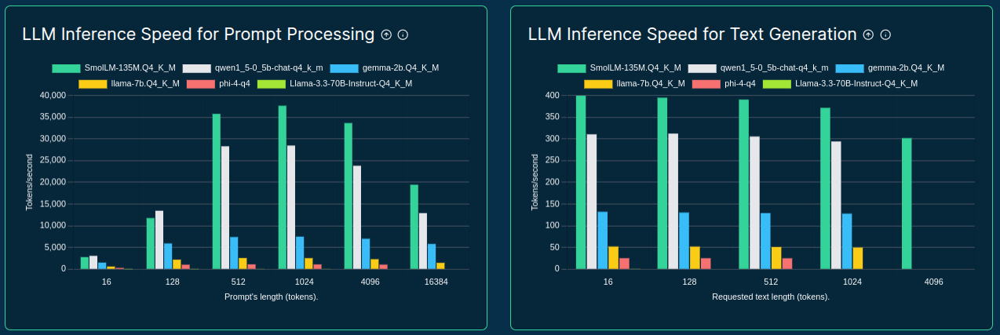
</a>

::: {.notes}
Or looking at LLM Inference Speed both for prompt processing and text generation,
using smaller models with 135M parameters up to 70B larger models.
:::

## >>> from navigator.www import server

<a href="https://sparecores.com/server/gcp/g2-standard-16" target="_blank">
  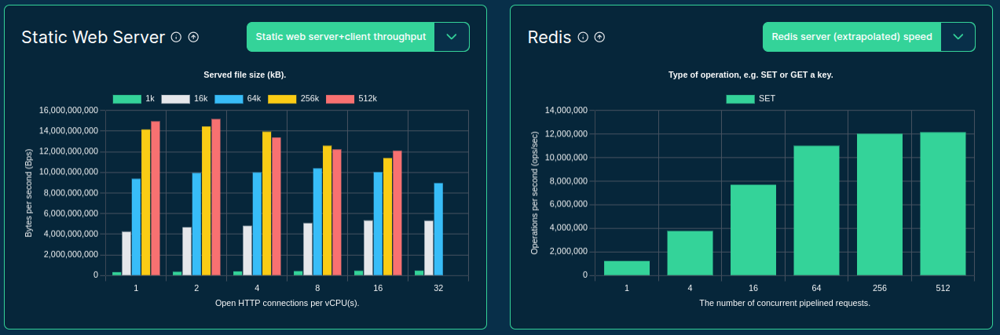
</a>

::: {.notes}
and other application-specific benchmarks, like serving a static website or running a key-value store database
:::

## $ curl sparecores.com/servers/compare

::: {.centered}
<a href="https://sparecores.com/compare?instances=W3sidmVuZG9yIjoiYXdzIiwic2VydmVyIjoiYzVhZC4xMnhsYXJnZSJ9LHsidmVuZG9yIjoiYXdzIiwic2VydmVyIjoiYzVkLjJ4bGFyZ2UifSx7InZlbmRvciI6ImF3cyIsInNlcnZlciI6ImM2Zy4xNnhsYXJnZSJ9LHsidmVuZG9yIjoiaGNsb3VkIiwic2VydmVyIjoiY2N4MzMifV0%3D" target="_blank">
  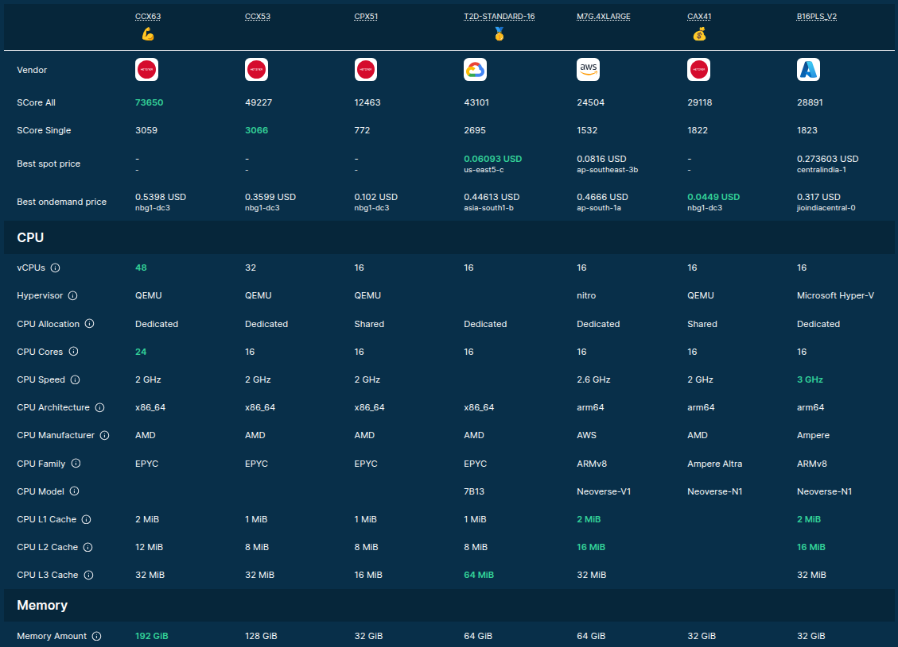
</a>
:::

::: {.notes}
and making all these data available in comparison tables,
e.g. you can see "Best performance servers for Redis below ¢50/hour" here
:::

## $ curl sparecores.com/servers/compare

::: {.centered}
<a href="https://sparecores.com/compare?instances=W3sidmVuZG9yIjoiYXdzIiwic2VydmVyIjoiYzVhZC4xMnhsYXJnZSJ9LHsidmVuZG9yIjoiYXdzIiwic2VydmVyIjoiYzVkLjJ4bGFyZ2UifSx7InZlbmRvciI6ImF3cyIsInNlcnZlciI6ImM2Zy4xNnhsYXJnZSJ9LHsidmVuZG9yIjoiaGNsb3VkIiwic2VydmVyIjoiY2N4MzMifV0%3D" target="_blank">
  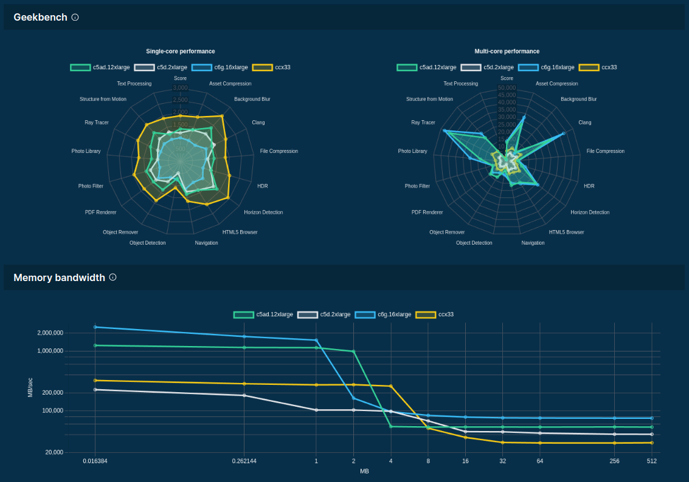
</a>
:::

::: {.notes}
or plots as well for human inspection
:::

# $ curl sparecores.com/advisor


::: {.centered}
<a href="https://sparecores.com/advisor?baseline_vendor=aws&baseline_server=r5a.large&limit_cpu_allocation=true&workload_id=passmark:cpu_single_threaded_test&workload_config=%7B%7D&avg_cpu_utilization=100&minimum_memory=16&price_allocation_enabled=true&best_price_allocation=ONDEMAND_ONLY&order_by=selected_benchmark_score_per_price&order_dir=desc" target="_blank">
  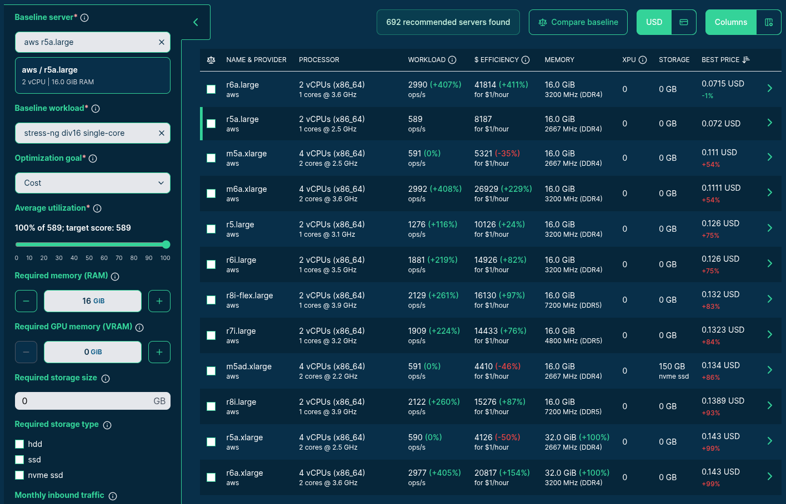
</a>
:::

::: {.notes}
r5a.large
"cpu_single_threaded_test"
AWS
Oregon
ondemand price

1. look at cheaper options
2. order by cost efficiency
3. exclude more expensive options

TODO add speaker notes
:::

# $ curl docs.sparecores.com/api

::: {.centered}
<a href="https://docs.sparecores.com/api" target="_blank">
  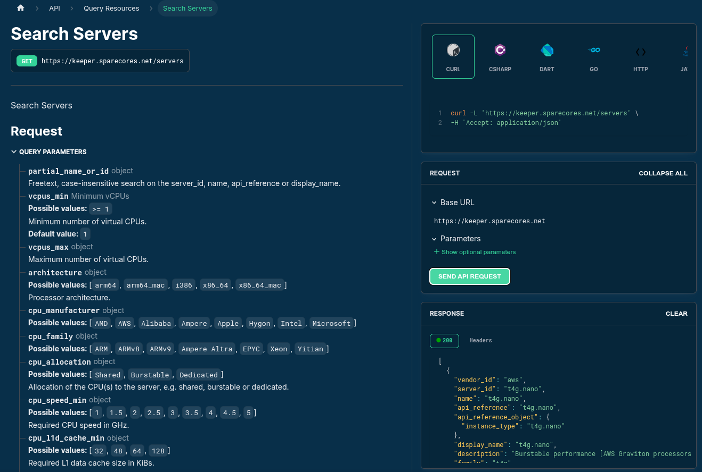
</a>
:::

::: {.notes}
for computers, we provide APIs: example

- min frequency of 5 ghz
- add total count header
- run
- check header
- check a few examples
- show other endpoints
:::

# $ pip install sparecores-data

```py {code-line-numbers="2|3|4-6|7|10-11|16|21-29|30-34|36-39|41-60|53-54|62-69" style="margin-top: 20px !important; height: 640px;"}
>>> from rich import print as pp
>>> from sc_crawler.tables import Server
>>> from sc_data import db
>>> from sqlmodel import create_engine, Session, select
>>> engine = create_engine(f"sqlite:///{db.path}")
>>> session = Session(engine)
>>> server = session.exec(select(Server).where(Server.server_id == 'g4dn.xlarge')).one()
>>> pp(server)
Server(
    server_id='g4dn.xlarge',
    vendor_id='aws',
    display_name='g4dn.xlarge',
    api_reference='g4dn.xlarge',
    name='g4dn.xlarge',
    family='g4dn',
    description='Graphics intensive [Instance store volumes] [Network and EBS optimized] Gen4 xlarge',

    status=<Status.ACTIVE: 'active'>,
    observed_at=datetime.datetime(2024, 6, 6, 10, 18, 4, 127254),

    hypervisor='nitro',
    vcpus=4,
    cpu_cores=2,
    cpu_allocation=<CpuAllocation.DEDICATED: 'Dedicated'>,
    cpu_manufacturer='Intel',
    cpu_family='Xeon',
    cpu_model='8259CL',
    cpu_architecture=<CpuArchitecture.X86_64: 'x86_64'>,
    cpu_speed=3.5,
    cpu_l1i_cache=64,
    cpu_l1d_cache=32,
    cpu_l2_cache=2048,
    cpu_l3_cache=36608,
    cpu_flags=["fpu", "vme", "avx512", ...],

    memory_amount=16384,
    memory_generation=<DdrGeneration.DDR4: 'DDR4'>,
    memory_speed=3200,
    memory_ecc=None,

    gpu_count=1,
    gpu_memory_min=16384,
    gpu_memory_total=16384,
    gpu_manufacturer='Nvidia',
    gpu_family='Turing',
    gpu_model='Tesla T4',
    gpus=[
        {
            'manufacturer': 'Nvidia',
            'family': 'Turing',
            'model': 'Tesla T4',
            'memory': 15360,
            'firmware_version': '535.171.04',
            'bios_version': '90.04.96.00.A0',
            'graphics_clock': 1590,
            'sm_clock': 1590,
            'mem_clock': 5001,
            'video_clock': 1470
        }
    ],

    storage_size=125,
    storage_type=<StorageType.NVME_SSD: 'nvme ssd'>,
    storages=[{'size': 125, 'storage_type': 'nvme ssd'}],

    network_speed=5.0,
    inbound_traffic=0.0,
    outbound_traffic=0.0,
    ipv4=0,
)
```

::: {.notes}
and SDKs as well, e.g. querying the details of this instance type: SCROLL through!
:::

# $ sqlite3 spare-cores-navigator.db {#import-sqlite3}

::: {.notes}
Let's load the database,
and ease in with a few descriptive stats on the 5,000 cloud server types you can order,
ranging from a potato to actual beasts with 2,000 vCPUs and over 30TB of memory!

You can deploy these instances across 600 availability zones around the globe!

And that heavily affects the pricing of a single instance type,
besides price allocation of course that could be spot VS on-demand and reserved pricing.
Overall, you can easily see 10x or even 15x diff for the same silicon!
As you can see here an AWS example as a tribute to the sponsor of tonight's social event.

We have actually started all these machines and run over 500 benchmark workloads on each to measure the actual performance.
:::

```sql {code-line-numbers="1-2|5-13|15-20|22-27|29-47|50-56|58-78" style="font-size:36px; margin-top: 30px !important; height: 600px;"}
SQLite version 3.46.1
Enter ".help" for usage hints.

sqlite> .mode table
sqlite> SELECT status, COUNT(*) FROM server GROUP BY status;
+------------------------+----------+
|         status         | COUNT(*) |
+------------------------+----------+
| ACTIVE                 | 4677     |
| INACTIVE               | 1143     |
| PLANNED_FOR_RETIREMENT | 130      |
| RETIRED                | 49       |
+------------------------+----------+

sqlite> SELECT MIN(vcpus), MIN(memory_amount/1024) FROM server;
+------------+-------------------------+
| MIN(vcpus) | MIN(memory_amount/1024) |
+------------+-------------------------+
| 1          | 0.5                     |
+------------+-------------------------+

sqlite> SELECT MAX(vcpus), MAX(memory_amount/1024) FROM server;
+------------+-------------------------+
| Max(vcpus) | MAX(memory_amount/1024) |
+------------+-------------------------+
| 1920       | 32768.0                 |
+------------+-------------------------+

sqlite> SELECT z.vendor_id, 
               COUNT(DISTINCT(continent)) AS continents, 
               COUNT(DISTINCT(country_id)) AS countries,
               COUNT(DISTINCT(z.region_id)) AS regions,
               COUNT(*) AS zones
        FROM zone AS z JOIN region USING (region_id) JOIN country USING (country_id)
        GROUP BY 1;
+-----------+------------+-----------+---------+@@box@@-------+
| vendor_id | continents | countries | regions | zones |
+-----------+------------+-----------+---------+-------+
| alicloud  | 5          | 19        | 34      | 148   |
| aws       | 6          | 29        | 34      | 153   |
| azure     | 6          | 31        | 64      | 149   |
| gcp       | 6          | 29        | 43      | 132   |
| hcloud    | 3          | 4         | 6       | 6     |
| ovh       | 4          | 9         | 29      | 33    |
| upcloud   | 4          | 12        | 15      | 15    |
| vultr     | 6          | 20        | 36      | 36    |
+-----------+------------+-----------+---------+-------@@box@@+


sqlite> SELECT COUNT(*), MIN(price), ROUND(AVG(price), 4) AS "AVG(price)", MAX(price)
        FROM server_price WHERE vendor_id = 'aws' AND server_id = 'm8g.2xlarge';
+----------+------------+------------+------------+
| COUNT(*) | MIN(price) | AVG(price) | MAX(price) |
+----------+------------+------------+------------+
| 199      | 0.04       | 0.2789     | 0.5722     |
+----------+------------+------------+------------+

sqlite> SELECT category, COUNT(*) FROM benchmark_score
        JOIN benchmark USING (benchmark_id) GROUP BY 1;
+---------------------+----------+
|      category       | COUNT(*) |
+---------------------+----------+
|                     | 2346     |
| Compression algos   | 1112565  |
| Database            | 4307     |
| Geekbench           | 199886   |
| LLM inference speed | 118898   |
| Memory bandwidth    | 190412   |
| Memory latency      | 23757    |
| OpenSSL             | 239118   |
| Other               | 3629     |
| Passmark            | 57680    |
| Redis               | 64980    |
| Static web server   | 544505   |
| Workload profile    | 25185    |
| stress-ng           | 74703    |
+---------------------+----------+
```

## $ sqlite3 spare-cores-navigator.db {#llama-3_3}

::: {.notes}
So which server to pick? Let's combine the above with a few CTEs finding the most cost-efficient server when it comes to text generation using the llama 3.3 model with 70B parameters.
So a query now sorted by dollars spent per million generated tokens.

- It's not a surprise: this list is heavily biased towards GPU instances across multiple vendors

As everyone knows nowadays that you need a GPU to run LLMs, right?
Except when you don't.
:::

```sh {code-line-numbers="1-4|5-8|9-16|18-19|21-49" data-fragment-index="0" style="font-size:25px; margin-top: 30px !important; height: 600px;"}
sqlite> WITH prices AS (
  SELECT vendor_id, server_id, ROUND(AVG(price), 2) AS price FROM server_price
  WHERE allocation = 'ONDEMAND' GROUP BY vendor_id, server_id
),
workload AS (
  SELECT DISTINCT vendor_id, server_id, score FROM benchmark_score
  WHERE benchmark_id = 'llm_speed:text_generation' AND config = '{"model": "Llama-3.3-70B-Instruct-Q4_K_M.gguf", "tokens": 128}'
)
SELECT
  vendor_id, api_reference,
  vcpus, memory_amount/1024 AS memory, gpu_count, gpu_model, gpu_memory_total/1024 AS VRAM,
  ROUND(score, 2) AS score, price, ROUND(score / price, 4) AS "$ efficiency",
  ROUND(price / (score * 60 * 60 / 1_000_000 ), 4) AS "$ per 1M token"
FROM server
LEFT JOIN prices USING (vendor_id, server_id)
LEFT JOIN workload USING (vendor_id, server_id)
WHERE score IS NOT NULL
ORDER BY 11 ASC
LIMIT 25;

+-----------+----------------------+-------+--------+-----------+@@box@@--------------+------+-------+-------+--------------+----------------+
| vendor_id |    api_reference     | vcpus | memory | gpu_count |  gpu_model   | VRAM | score | price | $ efficiency | $ per 1M token |
+-----------+----------------------+-------+--------+-----------+--------------+------+-------+-------+--------------+----------------+
| gcp       | a2-ultragpu-1g       | 12    | 170    | 1.0       | A100         | 80   | 24.47 | 1.36  | 17.9959      | 15.4356        |
| gcp       | a2-highgpu-2g        | 24    | 170    | 2.0       | A100         | 80   | 22.39 | 1.82  | 12.3027      | 22.5786        |
| ovh       | t2-le-90             | 30    | 90     | 2.0       | V100S        | 64   | 18.65 | 1.6   | 11.6566      | 23.8301        |
| ovh       | t2-90                | 30    | 90     | 2.0       | V100S        | 64   | 18.63 | 1.6   | 11.6414      | 23.8612        |
| ovh       | l40s-90              | 15    | 90     | 1.0       | L40S         | 48   | 15.72 | 1.4   | 11.2273      | 24.7414        |
| ovh       | h100-380             | 30    | 380    | 1.0       | H100         | 80   | 29.12 | 2.8   | 10.4015      | 26.7055        |
| gcp       | a2-ultragpu-2g       | 24    | 340    | 2.0       | A100         | 160  | 24.17 | 2.71  | 8.9172       | 31.1507        |
| ovh       | a10-90               | 60    | 85     | 2.0       | A10          | 48   | 10.67 | 1.52  | 7.018        | 39.581         |
| ovh       | rtx5000-84           | 16    | 84     | 3.0       | RTX 5000     | 48   | 7.46  | 1.08  | 6.9072       | 40.2154        |
| aws       | g7e.4xlarge          | 16    | 128    | 1.0       | RTX Pro 6000 | 96   | 31.01 | 4.73  | 6.5553       | 42.3744        |
| hcloud    | ccx53                | 32    | 128    | 0.0       |              |      | 2.36  | 0.38  | 6.2082       | 44.744         |
| ovh       | t1-le-180            | 32    | 180    | 4.0       | V100         | 64   | 16.77 | 2.8   | 5.9908       | 46.3677        |
| ovh       | t2-le-180            | 60    | 180    | 4.0       | V100S        | 128  | 18.53 | 3.2   | 5.792        | 47.9588        |
| ovh       | l40s-180             | 30    | 180    | 2.0       | L40S         | 96   | 15.56 | 2.8   | 5.5579       | 49.9788        |
| hcloud    | ccx63                | 48    | 192    | 0.0       |              |      | 3.19  | 0.58  | 5.4999       | 50.5062        |
| gcp       | a2-highgpu-4g        | 48    | 340    | 4.0       | A100         | 160  | 19.59 | 3.65  | 5.3683       | 51.7444        |
| gcp       | g2-standard-24       | 24    | 96     | 2.0       | L4           | 44   | 5.73  | 1.07  | 5.3593       | 51.8306        |
| ovh       | h100-760             | 60    | 760    | 2.0       | H100         | 160  | 29.48 | 5.6   | 5.2637       | 52.7723        |
| aws       | g7e.8xlarge          | 32    | 256    | 1.0       | RTX Pro 6000 | 96   | 31.02 | 6.24  | 4.9709       | 55.8813        |
| azure     | NC24ads_A100_v4      | 24    | 220    | 1.0       | A100         | 80   | 23.05 | 4.71  | 4.8934       | 56.7656        |
| aws       | g6e.4xlarge          | 16    | 128    | 1.0       | L40S         | 44   | 15.91 | 3.44  | 4.6237       | 60.0765        |
| ovh       | l4-180               | 45    | 180    | 2.0       | L4           | 48   | 5.78  | 1.5   | 3.8532       | 72.0904        |
| gcp       | a2-ultragpu-4g       | 48    | 680    | 4.0       | A100         | 320  | 20.78 | 5.42  | 3.8343       | 72.4462        |
| ovh       | a10-180              | 120   | 170    | 4.0       | A10          | 96   | 10.73 | 3.04  | 3.528        | 78.7359        |
| ovh       | a10-45               | 30    | 42     | 1.0       | A10          | 24   | 2.39  | 0.76  | 3.1439       | 88.3539        |
+-----------+----------------------+-------+--------+-----------+--------------@@box@@+------+-------+-------+--------------+----------------+
```

<script>
  // Quarto line-highlight reads data-fragment-index from <code>, not the wrapper div.
  // Starting at 0 keeps overlay/data-fragment-index in sync with code-line-numbers steps.
  (function () {
    var slide = document.getElementById('llama-3_3');
    if (!slide) return;
    slide.querySelectorAll('div.sourceCode[data-code-line-numbers]').forEach(function (div) {
      var code = div.querySelector('pre code');
      if (!code) return;
      code.setAttribute('data-fragment-index', div.getAttribute('data-fragment-index') || '0');
    });
  })();
</script>

```{=html}
<!-- fragment index 1 = 2nd code-line-numbers step (21-49 results); show on click, hide on next -->
<div class="slide-image-overlay fragment fade-in-then-out" data-fragment-index="1">
  
</div>
```

## $ sqlite3 spare-cores-navigator.db {#gemma}

::: {.notes}
Like when you don't need that many parameters, and you are fine with a small language model, such as the gemma with 2B parameters.

Same query -- with a different parameter, very different recommendations for which cloud server to use.

As you can easily find cheap CPU nodes with reasonable performance at 10 US cents per 1M output token!
:::

```sh {code-line-numbers="7-7|21-49" style="font-size:25px; margin-top: 30px !important; height: 600px;"}
sqlite> WITH prices AS (
  SELECT vendor_id, server_id, ROUND(AVG(price), 2) AS price FROM server_price
  WHERE allocation = 'ONDEMAND' GROUP BY vendor_id, server_id
),
workload AS (
  SELECT DISTINCT vendor_id, server_id, score FROM benchmark_score
  WHERE benchmark_id = 'llm_speed:text_generation' AND config = '{"model": "gemma-2b.Q4_K_M.gguf", "tokens": 128}'
)
SELECT
  vendor_id, api_reference,
  vcpus, memory_amount/1024 AS memory, gpu_count, gpu_model, gpu_memory_total/1024 AS VRAM,
  ROUND(score, 2) AS score, price, ROUND(score / price, 4) AS "$ efficiency",
  ROUND(price / (score * 60 * 60 / 1_000_000 ), 4) AS "$ per 1M token"
FROM server
LEFT JOIN prices USING (vendor_id, server_id)
LEFT JOIN workload USING (vendor_id, server_id)
WHERE score IS NOT NULL
ORDER BY 11 ASC
LIMIT 25;

+-----------+-----------------------+-------+--------+-----------+-----------+------+--------+-------+--------------+@@box+@@----------------+
| vendor_id |     api_reference     | vcpus | memory | gpu_count | gpu_model | VRAM | score  | price | $ efficiency | $ per 1M token |
+-----------+-----------------------+-------+--------+-----------+-----------+------+--------+-------+--------------+----------------+
| hcloud    | cx33                  | 4     | 8      | 0.0       |           |      | 26.83  | 0.01  | 2682.7252    | 0.1035         |
| hcloud    | cx43                  | 8     | 16     | 0.0       |           |      | 45.35  | 0.02  | 2267.7165    | 0.1225         |
| hcloud    | cx53                  | 16    | 32     | 0.0       |           |      | 60.02  | 0.04  | 1500.5479    | 0.1851         |
| hcloud    | cx32                  | 4     | 8      | 0.0       |           |      | 12.32  | 0.01  | 1231.8573    | 0.2255         |
| hcloud    | cpx42                 | 8     | 16     | 0.0       |           |      | 53.83  | 0.05  | 1076.5084    | 0.258          |
| hcloud    | cax21                 | 4     | 8      | 0.0       |           |      | 10.31  | 0.01  | 1030.5204    | 0.2696         |
| hcloud    | cpx32                 | 4     | 8      | 0.0       |           |      | 30.75  | 0.03  | 1024.8748    | 0.271          |
| hcloud    | cpx21                 | 3     | 4      | 0.0       |           |      | 19.94  | 0.02  | 996.9937     | 0.2786         |
| hcloud    | cax31                 | 8     | 16     | 0.0       |           |      | 18.74  | 0.02  | 936.8434     | 0.2965         |
| hcloud    | cpx52                 | 12    | 24     | 0.0       |           |      | 73.21  | 0.08  | 915.1476     | 0.3035         |
| hcloud    | cpx62                 | 16    | 32     | 0.0       |           |      | 87.79  | 0.1   | 877.9221     | 0.3164         |
| hcloud    | cpx31                 | 4     | 8      | 0.0       |           |      | 26.01  | 0.03  | 866.9372     | 0.3204         |
| hcloud    | cpx22                 | 2     | 4      | 0.0       |           |      | 17.19  | 0.02  | 859.4776     | 0.3232         |
| hcloud    | cpx41                 | 8     | 16     | 0.0       |           |      | 38.09  | 0.05  | 761.7758     | 0.3646         |
| gcp       | g2-standard-4         | 4     | 16     | 1.0       | L4        | 22   | 129.61 | 0.18  | 720.0422     | 0.3858         |
| hcloud    | cx23                  | 2     | 4      | 0.0       |           |      | 6.87   | 0.01  | 686.9441     | 0.4044         |
| hcloud    | cx22                  | 2     | 4      | 0.0       |           |      | 6.24   | 0.01  | 624.3952     | 0.4449         |
| upcloud   | CLOUDNATIVE-2xCPU-4GB | 2     | 4      | 0.0       |           |      | 11.71  | 0.02  | 585.7258     | 0.4742         |
| hcloud    | cax41                 | 16    | 32     | 0.0       |           |      | 22.75  | 0.04  | 568.7028     | 0.4884         |
| hcloud    | cx42                  | 8     | 16     | 0.0       |           |      | 16.74  | 0.03  | 558.1032     | 0.4977         |
| hcloud    | cax11                 | 2     | 4      | 0.0       |           |      | 5.47   | 0.01  | 547.0548     | 0.5078         |
| hcloud    | cpx11                 | 2     | 2      | 0.0       |           |      | 4.91   | 0.01  | 490.7897     | 0.566          |
| hcloud    | ccx13                 | 2     | 8      | 0.0       |           |      | 9.69   | 0.02  | 484.6809     | 0.5731         |
| ovh       | rtx5000-28            | 4     | 28     | 1.0       | RTX 5000  | 16   | 158.95 | 0.36  | 441.5258     | 0.6291         |
| hcloud    | cpx51                 | 16    | 32     | 0.0       |           |      | 45.26  | 0.11  | 411.4147     | 0.6752         |
+-----------+-----------------------+-------+--------+-----------+-----------+------+--------+-------+--------------+----------------@@box+@@+

```

# {#gilty-goes-k8s .center}

::: {.centered}

:::

::: {.notes}
https://www.cncf.io/phippy/
:::

## {#gilty-at-k8s-demo}

```{=html}
<link rel="stylesheet" href="https://cdn.jsdelivr.net/npm/asciinema-player@3.8.0/dist/bundle/asciinema-player.css" />
<div id="demo-player" style="width: 90%; height: 730px; margin-left: auto; margin-right: auto; margin-top: -30px;margin-bottom: 0px;"></div>
<script src="https://cdn.jsdelivr.net/npm/asciinema-player@3.8.0/dist/bundle/asciinema-player.min.js"></script>
<script>
  (function () {
    const el = document.getElementById("demo-player");
    const player = AsciinemaPlayer.create(
      "casts/sc-karpenter-nodepool-demo.cast",
      el,
      { fit: "both", poster: "npt:0:6", preload: true }
    );
    // keep Space/arrows inside the player once clicked; clicker keys still navigate slides
    el.addEventListener("keydown", function (e) {
      if (e.key !== "PageDown" && e.key !== "PageUp") e.stopPropagation();
    });
    window.addEventListener("load", function () {
      Reveal.on("slidechanged", function () {
        player.pause();
        if (document.activeElement && el.contains(document.activeElement)) {
          document.activeElement.blur();
        }
      });
    });
  })();
</script>

<p class="centered" style="margin-top: -30px;">
  <a href="https://sparecores.github.io/sc-karpenter-nodepool/demo/" target="_blank" class="centered" style="margin-top: -30px;">
    <code>sc-karpenter-nodepool</code> demo
  </a>
</p>
```

::: {.notes}
TODO Attila speaker notes
:::

# $ ping sparecores.com {#bye}

```{=html}
<style>
  .reveal .bye-layout {
    display: flex;
    align-items: center;
    justify-content: space-between;
    gap: 1.5em;
    margin-top: 1em;
  }

  .reveal .bye-layout .bye-contacts {
    font-size: 0.6em;
  }

  .reveal .bye-layout .bye-group + .bye-group {
    margin-top: 1.6em;
  }

  .reveal .bye-layout .bye-contacts h3 {
    margin: 0 0 0.2em;
    font-size: 1.15em;
    text-transform: none;
  }

  .reveal .bye-layout .bye-contacts p {
    display: flex;
    align-items: baseline;
    gap: 0.6em;
    margin: 0.15em 0;
  }

  .reveal .bye-layout .bye-contacts span {
    flex: 0 0 6.5em;
    white-space: nowrap;
    color: #94a3b8;
    font-size: 0.8em;
    text-transform: uppercase;
    letter-spacing: 0.05em;
  }

  .reveal .bye-layout .bye-slides {
    flex: 0 0 auto;
    font-size: 0.8em;
    text-align: center;
  }

  .reveal .bye-layout .qr-card-canvas {
    width: 10em;
    height: 10em;
  }
</style>
<div class="bye-layout">
  <div class="bye-contacts fragment" data-fragment-index="2">
    <div class="bye-group">
      <h3>Spare Cores</h3>
      <p><span>Web</span><a href="https://sparecores.com" target="_blank">sparecores.com</a></p>
      <p><span>Docs</span><a href="https://docs.sparecores.com" target="_blank">docs.sparecores.com</a></p>
      <p><span>GitHub</span><a href="https://github.com/SpareCores" target="_blank">github.com/SpareCores</a></p>
      <p><span>LinkedIn</span><a href="https://linkedin.com/company/SpareCores" target="_blank">linkedin.com/company/SpareCores</a></p>
      <p><span>Email</span><a href="mailto:hi@sparecores.com">hi@sparecores.com</a></p>
    </div>
    <div class="bye-group">
      <h3>Gergely Daroczi</h3>
      <p><span>LinkedIn</span><a href="https://www.linkedin.com/in/daroczig/" target="_blank">linkedin.com/in/daroczig</a></p>
      <p><span>Email</span><a href="mailto:daroczig@sparecores.com">daroczig@sparecores.com</a></p>
    </div>
  </div>
  <div class="bye-slides fragment" data-fragment-index="1">
    <div class="qr-card" data-qr="https://sparecores.com/talks"></div>
  </div>
</div>
```


:::{.notes}
Thank you!
TODO add speaker notes
:::


<p class="author offlineMode" style="color:#eee;font-size:0.75em;text-align: center !important; margin-top:-30px; padding-top:0px;">
  Slides: <a href="https://sparecores.com/talks" target="_blank">sparecores.com/talks</a>
</p>

<!--toggle visibility of items in live mode-->
<script>
var url = document.location.href;
if (url.match("/?live")) {
  const elements = document.getElementsByClassName('offlineMode');
  for (let i = 0; i < elements.length; i++) {
    element = elements.item(i);
    element.style.display = 'none';
  }
} else {
  const elements = document.getElementsByClassName('onlineMode');
  for (let i = 0; i < elements.length; i++) {
    element = elements.item(i);
    element.style.display = 'none';
  }
}
</script>


